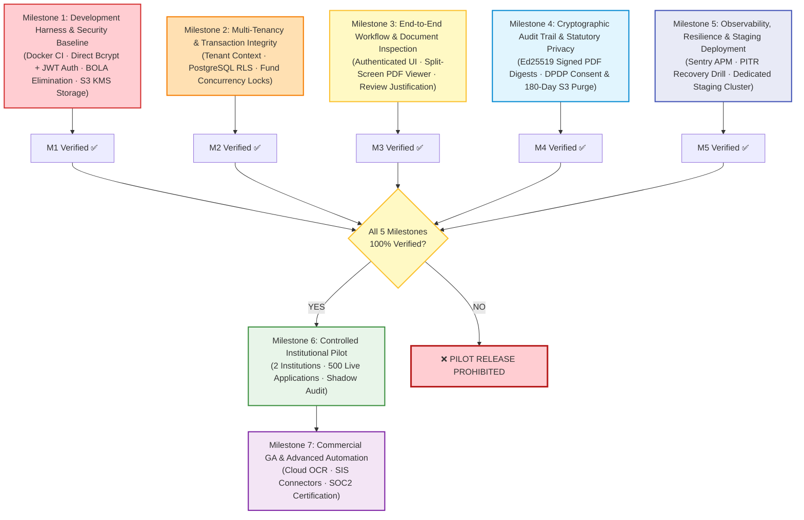

# FairExplain AI — Master Implementation Plan (Authoritative Single Source of Truth)

**Document Version:** 1.1.0  
**Effective Date:** October 25, 2026  
**Governance Status:** **Authoritative Master Plan** (Formally supersedes all prior roadmaps)  
**Lead Architect & Auditor:** Senior Staff Software Engineer, Security Auditor & Product Architect  
**Repository:** `https://github.com/manthanshah/FairExplain-AI`

---

## 1. Architectural & Planning Principles

1. **Dependency-First Sequencing:** Security perimeters, database consistency, and durable storage must precede end-to-end UI polish and advanced AI integrations.
2. **Deterministic Primacy:** The pure Python rule engine ([`backend/app/domain/`](file:///Users/manthanshah/Documents/FairExplain/FairExplain-AI/backend/app/domain)) remains the immutable single source of truth for all financial numbers and eligibility decisions. Generative AI may explain, but may never calculate or mutate decisions.
3. **Traceability & Verification:** Every task must possess executable acceptance criteria, negative security test assertions, and an unambiguous Definition of Done.
4. **Invariant Rule of Pilot Clearance:**
   $$\text{Gate 2 (Pilot Clearance)} \iff \bigwedge_{i=1}^{5} \big(\text{Milestone } i \text{ Definition of Done} = \mathbf{VERIFIED}\big)$$
   No live applications, student PII, or university budgets may be ingested in a pilot until Milestones 1 through 5 are 100% complete and verified.
5. **Unified Multi-Tenant Schema:** A single schema with dual-layer isolation (`institution_id` query scoping + PostgreSQL Row-Level Security) serves both multi-tenant cloud and sovereign single-tenant campus deployments without throwaway code or post-pilot rewrites.

---

## 2. Sequenced Implementation Milestones

---

### Milestone 1: Development Harness & Security Baseline (P0 — Absolute Blocker)

* **Objective & Scope:** Eliminate existential security vulnerabilities (unauthenticated endpoints, BOLA, hardcoded passwords, ephemeral file storage) and make backend integration tests 100% reproducible in CI without dependence on local workstation user accounts.
* **Why at this stage:** No feature development or staging deployment can safely occur while the API allows public enumeration of student PII or suffers data loss on container restarts.
* **Concrete Code Areas to Change:**
  - `backend/requirements.txt` (Add `aioboto3`, update dependencies)
  - `backend/app/core/dependencies.py` (Create JWT auth & role dependencies)
  - `backend/app/core/security.py` (Password hashing via direct `bcrypt`, JWT token generation via `python-jose`)
  - `backend/app/core/storage.py` (Implement `S3StorageBackend` with pre-signed URLs; deprecate `LocalStorageBackend`)
  - `backend/app/routers/` (Add `Depends(get_current_active_user)` to all routers)
  - `backend/app/services/application_service.py` (Remove hardcoded `demo_hashed_password`)
  - `docker-compose.test.yml` & `.github/workflows/ci.yml` (Ephemeral Postgres + MinIO test container)
* **Complete Session Security Contract:**
  - Password hashing: Direct `bcrypt` with cost factor 12 (`bcrypt.hashpw(password, bcrypt.gensalt(12))`).
  - Access Token: 15-minute TTL, HS256 signed with `JWT_SECRET_KEY`, transmitted via `Authorization: Bearer <token>` header. Contains `sub`, `email`, `role`, `type: "access"`, `iat`, `exp`, `jti`.
  - Refresh Token: 7-day TTL, transmitted strictly via cookie: `HttpOnly; Secure; SameSite=Strict; Path=/api/v1/auth; Max-Age=604800`.
  - Refresh Token Rotation (RTR): Invalidation on every refresh; replay triggers token family revocation.
  - Rate Limiting: `slowapi` 5 requests/minute on `POST /api/v1/auth/login`.
* **Object Storage Specification:**
  - Production: AWS S3 with Customer Managed Keys in AWS KMS (`SSE-KMS`). Pre-signed PUT/GET URLs with 15-minute expiration.
  - CI & Local: MinIO container in Docker Compose matching S3 API.
* **Acceptance Criteria:**
  - Calling any `/api/v1/application/*` or `/api/v1/admin/*` route without a Bearer token returns HTTP 401 Unauthorized.
  - Student A requesting Student B's application receives HTTP 403 Forbidden.
  - Document upload writes to S3 bucket; container restarts retain all files.
  - `pytest backend/tests` passes 100% in a clean Docker container without local environment variables.
* **Rollback & Recovery:** Standard Git commit revert and Alembic downgrade.
* **Explicitly Out of Scope:** Multi-tenant RLS (Milestone 2); SAML SSO (Milestone 7).

---

### Milestone 2: Multi-Tenancy & Transaction Integrity (P0 — Blocker for Pilot)

* **Objective & Scope:** Implement unified multi-tenant schema with dual-layer isolation (application tenant scoping + PostgreSQL Row-Level Security), introduce `scholarship_funds` model, and establish concurrency control (`with_for_update`) to prevent scholarship over-allocation.
* **Why at this stage:** When multiple financial aid officers simultaneously approve awards during admission season, uncoordinated database transactions will exhaust endowment funds beyond statutory caps.
* **Concrete Code Areas to Change:**
  - `backend/app/models/` (Add `institution_id` foreign keys to `users`, `applications`, `policies`, `uploaded_documents`; create `scholarship_funds.py`)
  - `backend/app/middleware/tenant.py` (Create tenant extraction middleware)
  - `backend/app/services/admin_service.py` & `scholarship_service.py` (Add pessimistic row locking)
  - `backend/alembic/versions/` (Schema migrations for tenancy and endowment funds)
* **Reconciled Architecture Specification:**
  1. Add `institution_id UUID REFERENCES institutions(id)` to all tenant-scoped tables.
  2. Implement `TenantContext` dependency injecting `WHERE institution_id = :current_tenant_id` on all queries.
  3. Activate PostgreSQL Row-Level Security (RLS) policies on all tenant tables with `current_setting('app.current_tenant_id')`.
  4. Create `scholarship_funds` table (`id`, `institution_id`, `program_id`, `total_budget`, `allocated_budget`, `remaining_budget`).
  5. Wrap reviewer award approval in an atomic transaction with `SELECT ... FOR UPDATE` row locking on `scholarship_funds`.
* **Acceptance Criteria:**
  - Users belonging to Institution A cannot query applications or policies belonging to Institution B under any circumstances (HTTP 404/403).
  - 20 concurrent simulated approval requests attempting to allocate a ₹10,00,000 fund with ₹20,00,000 total requested awards halt precisely when the fund reaches ₹0.00 without negative balances.
* **Test Strategy:** Concurrent integration test using `asyncio.gather` with 20 parallel workers; negative cross-tenant query assertions.
* **Explicitly Out of Scope:** External SAP / ERP financial ledger synchronization.

---

### Milestone 3: End-to-End Workflow & Document Inspection (P1 — Core Product)

* **Objective & Scope:** Wire the React frontend to live authenticated backend endpoints, eliminate all mock fallbacks in staging/production, and provide a split-screen document viewer for financial aid reviewers.
* **Why at this stage:** Institutional financial aid officers refuse to approve awards blindly; they require a side-by-side view of student PDF income proofs alongside calculated rule evaluations.
* **Concrete Code Areas to Change:**
  - `frontend/src/lib/auth.tsx` & `frontend/src/pages/auth-page.tsx` (Real login/registration UI)
  - `frontend/src/services/api-client.ts` (Remove silent mock fallback; attach Bearer token)
  - `frontend/src/pages/reviewer-portal.tsx` & `frontend/src/components/reviewer/` (Split-screen PDF viewer via PDF.js)
  - `backend/app/routers/documents.py` (Pre-signed document view redirect endpoint)
* **Acceptance Criteria:**
  - Full end-to-end user journey works against live backend: Student registers -> uploads PDF -> views evaluation -> Reviewer logs in -> views PDF in split-screen -> enters rationale -> approves award.
  - Network disconnect shows user-facing error banner, never silent mock fallback.
* **Test Strategy:** Playwright E2E test verifying student login, application submission, document upload, and reviewer approval.

---

### Milestone 4: Cryptographic Audit Trail & Statutory Privacy (P1 — Compliance Gate)

* **Objective & Scope:** Implement cryptographic server-side signatures for assessment reports, store immutable hash chains in `audit_logs`, and establish compliance controls for India’s DPDP Act 2023 (explicit consent logging and 180-day automated document purge).
* **Concrete Code Areas to Change:**
  - `backend/app/models/audit_log.py` (Add cryptographic digest and previous-hash fields)
  - `backend/app/services/pdf/hasher.py` & `report_generator.py` (Ed25519 signing)
  - `backend/app/routers/report.py` (Add `POST /api/v1/report/verify` endpoint)
  - `backend/app/services/retention_service.py` (Automated 180-day retention purge worker)
  - `frontend/src/components/forms/intake-form.tsx` (DPDP consent checkboxes)
* **Legal Review Boundary Flagged:**
  - The 180-day S3 document purge is an **operational engineering policy**. Formal legal counsel review is required to reconcile this with General Financial Rules (GFR, 2017) 3-to-8-year audit retention rules and UIDAI Aadhaar masking regulations.
* **Acceptance Criteria:**
  - Modifying a single byte in an official PDF dossier causes `POST /api/v1/report/verify` to return `{"verified": false, "reason": "CRYPTOGRAPHIC_SIGNATURE_INVALID"}`.
  - DPDP consent record is immutable and queryable by institutional auditors.
  - Retention purge worker successfully deletes expired files from S3 after 180 days while retaining hash receipts.

---

### Milestone 5: Observability, Resilience & Staging Deployment (P1 — Operational Gate)

* **Objective & Scope:** Install production-grade observability (Sentry error tracking, Prometheus metrics), configure connection pooling for serverless databases, conduct an automated point-in-time recovery (PITR) disaster recovery drill, and deploy to a dedicated staging environment.
* **Implementation Tasks:**
  1. Add `sentry-sdk` to backend and `@sentry/react` to frontend; configure environment-specific DSNs and transaction tracing.
  2. Expose `/metrics` endpoint using `prometheus-fastapi-instrumentator` tracking request latency, status codes, and rule evaluation durations.
  3. Configure SQLAlchemy engine settings for PgBouncer / Neon connection pooling (`pool_size=10`, `max_overflow=5`, `pool_recycle=1800`, `pool_pre_ping=True`).
  4. Execute tabletop Disaster Recovery drill: simulate database corruption, perform Neon PITR recovery, and verify total data integrity (target: RTO < 60 min, RPO < 15 min).
  5. Provision dedicated Staging environment with automated CD pipeline from `main` branch.
* **Acceptance Criteria:**
  - Unhandled backend exceptions trigger real-time Sentry alert with sanitized stack trace (zero PII in logs).
  - PITR drill restores database state to target timestamp with 100% calculation concordance.
* **Definition of Done:** Staging environment is live, authenticated, and verified by synthetic smoke tests.

---

### Milestone 6: Controlled Institutional Pilot (P1 — Validation Gate)

* **Entry Condition:** **Gate 2 Unlocked** (Milestones 1 through 5 verified 100%).
* **Objective & Scope:** Onboard 1–2 Higher Education Partner Institutions (e.g. NITK / autonomous engineering college) to process 500 live or parallel shadow applications with real financial aid officers.
* **Acceptance Criteria:**
  - 100% mathematical concordance between deterministic engine calculations and institutional manual spreadsheet audit across 500 sample applications.
  - ≥ 60% reduction in financial aid officer review time per application (from ~25 min manual down to < 10 min).
  - Written pilot acceptance certificate signed by the Lead Financial Aid Officer (Gate 2 exit).

---

### Milestone 7: Commercial GA & Advanced Automation (P2 — Expansion)

* **Objective & Scope:** Enterprise self-service onboarding, cloud document OCR integration (AWS Textract / Google Document AI), Student Information System (SIS) connectors, and formal SOC2 Type I compliance.

---

## 3. Requirement Traceability Matrix

| Requirement ID | User / Business Need | Current Implementation Status | Repository Evidence | Security / Data Integrity Risk | Acceptance Criteria | Dependencies | Priority | Milestone | Owning Role |
| :--- | :--- | :--- | :--- | :--- | :--- | :--- | :--- | :--- | :--- |
| **REQ-AUTH-01** | Student & Reviewer Authentication | Missing (0%) | [`backend/app/routers/`](file:///Users/manthanshah/Documents/FairExplain/FairExplain-AI/backend/app/routers) lacks auth deps; hardcoded demo passwords. | Unauthorized access to all student records and admin endpoints. | Requests without valid JWT return HTTP 401; passwords hashed with direct `bcrypt` (12 rounds). | None | **P0** | M1 | Lead Backend Engineer |
| **REQ-AUTH-02** | Object-Level Authorization (BOLA) | Missing (0%) | [`applications.py:44`](file:///Users/manthanshah/Documents/FairExplain/FairExplain-AI/backend/app/routers/applications.py#L44) allows querying any ID. | Student PII, family tax, and marksheet leakage across applicants. | Accessing an application not owned by `current_user` returns HTTP 403. | REQ-AUTH-01 | **P0** | M1 | Security Officer |
| **REQ-STOR-01** | Durable & Private Document Storage | Ephemeral Local Disk | [`storage.py:14`](file:///Users/manthanshah/Documents/FairExplain/FairExplain-AI/backend/app/core/storage.py#L14) writes to local `./uploads`. | Complete document loss on container restarts; zero encryption. | Files stored in private AWS S3 bucket with KMS encryption; access via 15-min pre-signed URLs. | AWS S3 / MinIO | **P0** | M1 | Infrastructure SRE |
| **REQ-TEN-01** | Multi-Tenant Data Isolation | Missing (0%) | Models lack `institution_id`; queries run flat. | Cross-institution data leakage; compliance breach. | Queries scoped to user's `institution_id`; PostgreSQL RLS blocks cross-tenant access. | REQ-AUTH-01 | **P0** | M2 | Lead Backend Architect |
| **REQ-FIN-01** | Deterministic Eligibility & Accounting | Implemented (100%) | [`backend/app/domain/`](file:///Users/manthanshah/Documents/FairExplain/FairExplain-AI/backend/app/domain); 70 unit tests pass. | Financial miscalculation, negative tuition balance, or rounding drift. | Pure Decimal arithmetic; 3-state evaluation; 100% unit test pass rate. | None | **P0** | Done | Domain Specialist |
| **REQ-FIN-02** | Endowment Fund Concurrency Control | Missing Schema & Locks | No `EndowmentFund` table; no `FOR UPDATE` locks. | Over-allocation of scholarship funds under concurrent approvals. | Parallel approvals halt when fund reaches ₹0.00; zero negative balances. | REQ-TEN-01 | **P0** | M2 | Database Architect |
| **REQ-UI-01** | Split-Screen Reviewer Dossier | Implemented with Mocks | [`reviewer-portal.tsx`](file:///Users/manthanshah/Documents/FairExplain/FairExplain-AI/frontend/src/pages/reviewer-portal.tsx); falls back to mock provider. | Reviewer approves awards without inspecting official document seals. | Reviewer inspects PDF in left pane alongside computed facts; records mandatory rationale. | REQ-AUTH-01, REQ-STOR-01 | **P1** | M3 | Lead Frontend Engineer |
| **REQ-AI-01** | Grounded Plain-English AI Explanation | Implemented & Guardrailed | [`explanation_service.py`](file:///Users/manthanshah/Documents/FairExplain/FairExplain-AI/backend/app/services/explanation_service.py); one-way data contract. | LLM hallucinates award amounts or alters eligibility booleans. | LLM receives read-only facts; response schema rejects numeric overrides; UI ribbon visible. | None | **P1** | M3 | Lead AI Engineer |
| **REQ-AUD-01** | Cryptographic Audit Log & Verification | Partially Implemented | [`hasher.py`](file:///Users/manthanshah/Documents/FairExplain/FairExplain-AI/backend/app/services/pdf/hasher.py) generates unstored SHA-256 header. | Unverifiable audit trail; forged PDF cannot be detected. | Audit hash stored in DB; Ed25519 signature on PDF; verification API returns valid/invalid. | REQ-AUTH-01 | **P1** | M4 | Security Officer |
| **REQ-PRIV-01** | DPDP Act 2023 Consent & Retention | Missing Retention Engine | No automated purge script; basic audit logs. | Regulatory fines up to ₹250 Cr for unlawful PII retention. | Explicit student consent logged; identity documents auto-deleted from S3 after 180 days. | REQ-STOR-01 | **P1** | M4 | Compliance Officer |
| **REQ-OPS-01** | Observability & Error Tracking | Missing (0%) | No Sentry or Prometheus configured in backend/frontend. | Undetected outages during campus admissions. | Sentry alerts on unhandled 5xx; `/metrics` tracks P95 request latency. | None | **P1** | M5 | Infrastructure SRE |
| **REQ-DR-01** | Disaster Recovery & Point-In-Time Restore | Manual Configuration | Neon WAL archiving available; no drill conducted. | Catastrophic data loss in event of database corruption. | PITR drill successfully restores database within 60 minutes with < 15 min RPO. | Neon / RDS | **P1** | M5 | Infrastructure SRE |
