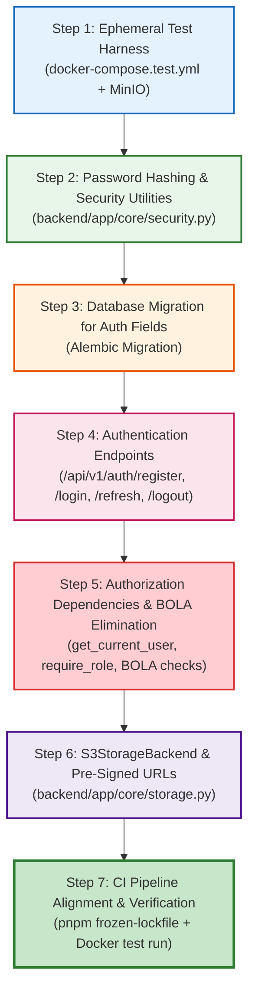

# FairExplain AI — Milestone 1 Implementation-Ready Task List

**Document Version:** 1.0.0  
**Effective Date:** October 25, 2026  
**Milestone Focus:** Development Harness, Server-Side Authentication, BOLA Elimination & S3 Storage  
**Target Duration:** 2 Weeks (10 Working Days)  
**Governance:** Gate 1 Prerequisite (P0 Absolute Blocker)  
**Status:** **READY FOR IMPLEMENTATION (No application code modified during planning phase)**

---

## 1. Exact Files and Modules to Inspect or Change

The following repository modules are within scope for inspection and modification during Milestone 1:

```
FairExplain-AI/
├── backend/
│   ├── requirements.txt                         [MODIFY: Add aioboto3==13.3.0, passlib==1.7.4, bcrypt==4.2.1]
│   ├── app/
│   │   ├── config/
│   │   │   └── settings.py                     [MODIFY: Add JWT_SECRET_KEY, S3_*, CORS settings]
│   │   ├── core/
│   │   │   ├── dependencies.py                 [CREATE: get_current_user, get_current_active_user, require_role]
│   │   │   ├── security.py                     [CREATE: direct bcrypt password hashing & JWT token generation]
│   │   │   └── storage.py                      [MODIFY: Implement S3StorageBackend using aioboto3; deprecate LocalStorageBackend]
│   │   ├── models/
│   │   │   └── user.py                         [MODIFY: Add is_verified, domain helper methods]
│   │   ├── routers/
│   │   │   ├── auth.py                         [CREATE: /api/v1/auth/register, /login, /refresh, /logout, /me]
│   │   │   ├── applications.py                 [MODIFY: Enforce get_current_user & BOLA ownership checks]
│   │   │   ├── admin.py                        [MODIFY: Enforce require_role(['reviewer', 'admin']) & bind reviewer_id]
│   │   │   ├── documents.py                    [MODIFY: Enforce get_current_user & pre-signed URL workflow]
│   │   │   └── report.py                       [MODIFY: Enforce ownership/role on PDF report download]
│   │   └── services/
│   │       └── application_service.py          [MODIFY: Remove hardcoded demo_hashed_password; link to auth user]
│   ├── alembic/
│   │   └── versions/
│   │       └── 20261026_0001_add_auth_fields.py [CREATE: Migration for user verification & session tokens]
│   └── tests/
│       ├── conftest.py                         [MODIFY: Add authenticated user fixtures, JWT headers, S3 mock]
│       ├── unit/
│       │   ├── test_security.py                [CREATE: Unit tests for password hashing & JWT lifecycle]
│       │   └── test_s3_storage.py              [CREATE: Unit tests for S3StorageBackend & pre-signed URLs]
│       └── integration/
│           ├── test_auth_api.py                [CREATE: Integration tests for register, login, refresh, logout]
│           └── test_authorization_bola.py      [CREATE: Security regression tests proving BOLA/IDOR is blocked]
├── docker-compose.test.yml                     [CREATE: Ephemeral Postgres 16 + MinIO container harness for CI]
└── .github/workflows/ci.yml                    [MODIFY: Align frontend to pnpm; wire Docker test harness]
```

---

## 2. Required Secrets & Infrastructure Prerequisites

Before executing Milestone 1 code changes, ensure the following environment variables and infrastructure components are configured in `.env` (development) and CI pipeline secrets:

| Variable Name | Purpose | Example / Development Default | Secret Type |
| :--- | :--- | :--- | :--- |
| `APP_ENV` | Application environment | `development` (or `staging`, `production`) | Config |
| `JWT_SECRET_KEY` | HS256 secret for signing access & refresh tokens | Minimum 256-bit random hex string (`openssl rand -hex 32`) | Secret |
| `JWT_ALGORITHM` | Signature algorithm | `HS256` | Config |
| `ACCESS_TOKEN_EXPIRE_MINUTES` | Access token lifespan | `15` | Config |
| `REFRESH_TOKEN_EXPIRE_DAYS` | Refresh token lifespan | `7` | Config |
| `ALLOWED_EMAIL_DOMAINS` | Institutional domain whitelist | `["nitk.edu.in", "iitb.ac.in", "edu.in"]` | Config |
| `STORAGE_BACKEND` | Storage backend type | `s3` (or `minio` in development) | Config |
| `S3_BUCKET_NAME` | S3 bucket for student documents | `fairexplain-documents-dev` | Config |
| `S3_REGION_NAME` | AWS Region | `ap-south-1` (Mumbai) | Config |
| `S3_ENDPOINT_URL` | S3 API endpoint URL | `http://localhost:9000` (MinIO) or omit for AWS | Config |
| `AWS_ACCESS_KEY_ID` | IAM credentials with S3 minimum permissions | Provisioned via IAM | Secret |
| `AWS_SECRET_ACCESS_KEY` | IAM secret key | Provisioned via IAM | Secret |
| `S3_KMS_KEY_ARN` | Customer Managed Key ARN for SSE-KMS | `arn:aws:kms:ap-south-1:...` (Production only) | Secret |

---

## 3. Ordered Implementation Steps

The tasks must be implemented in the exact dependency order below:



### Step 1: Ephemeral CI & Local Test Harness
1. Create `docker-compose.test.yml` running:
   - `postgres:16-alpine` on port 5433 (preventing conflict with local Postgres).
   - `minio/minio:RELEASE.2024-01-01T00-00-00Z` on ports 9000/9001 with test credentials.
2. Update `backend/tests/conftest.py` to use dynamically configured database URLs via environment variables (`TEST_DATABASE_URL`).
3. Verify that `docker compose -f docker-compose.test.yml up` stands up clean instances and runs `alembic upgrade head`.

### Step 2: Password Hashing & Security Module (`backend/app/core/security.py`)
1. Implement direct `bcrypt` password hashing:
   ```python
   def hash_password(plain_password: str) -> str:
       # Direct bcrypt avoiding passlib 1.7.4 / bcrypt 4.x bug
       return bcrypt.hashpw(plain_password.encode("utf-8"), bcrypt.gensalt(12)).decode("utf-8")

   def verify_password(plain_password: str, hashed_password: str) -> bool:
       return bcrypt.checkpw(plain_password.encode("utf-8"), hashed_password.encode("utf-8"))
   ```
2. Implement JWT token generation using `python-jose`:
   - `create_access_token(data: dict, expires_delta: timedelta | None = None) -> str`
   - `create_refresh_token(data: dict) -> str`
   - `decode_token(token: str) -> dict`

### Step 3: Database Migration (`backend/alembic/versions/`)
1. Generate migration: `alembic revision -m "add_auth_fields_and_sessions"`
2. Add columns to `users`:
   - `is_verified: bool` (default False)
   - `institutional_domain: str` (nullable=True)
3. Create `refresh_tokens` table for Refresh Token Rotation (RTR):
   - `id: UUID`, `user_id: UUID FK`, `token_hash: str`, `jti: str`, `revoked: bool`, `expires_at: datetime`.

### Step 4: Authentication Router (`backend/app/routers/auth.py`)
1. Implement `POST /api/v1/auth/register`:
   - Validates email against `ALLOWED_EMAIL_DOMAINS`.
   - Hashes password; creates `User` record with role `student`.
   - Returns HTTP 201 with sanitized user profile.
2. Implement `POST /api/v1/auth/login`:
   - Rate-limited via `slowapi` (5 attempts / min).
   - Verifies email and password; generates access token and refresh token.
   - Sets refresh token in `Set-Cookie: HttpOnly; Secure; SameSite=Strict; Path=/api/v1/auth; Max-Age=604800`.
   - Returns access token and user info in response body.
3. Implement `POST /api/v1/auth/refresh`:
   - Reads refresh token from cookie; validates signature and database record.
   - Performs token rotation: marks old token revoked; writes new token record.
   - Sets new cookie and returns new access token.
4. Implement `POST /api/v1/auth/logout`:
   - Clears cookie; marks active `jti` revoked in database.

### Step 5: Authorization Dependencies & BOLA Elimination
1. Create `backend/app/core/dependencies.py`:
   - `oauth2_scheme = OAuth2PasswordBearer(tokenUrl="/api/v1/auth/login")`
   - `get_current_user(token: str = Depends(oauth2_scheme), db: AsyncSession = Depends(get_db)) -> User`
   - `require_role(allowed_roles: list[UserRole])` dependency factory.
2. Update [`backend/app/routers/applications.py`](file:///Users/manthanshah/Documents/FairExplain/FairExplain-AI/backend/app/routers/applications.py):
   - In `POST /api/v1/application`: Bind `application.user_id = current_user.id`.
   - In `GET /api/v1/application/{id}`:
     ```python
     if app.user_id != current_user.id and current_user.role not in [UserRole.reviewer, UserRole.admin]:
         raise HTTPException(status_code=403, detail="Access denied to requested application.")
     ```
3. Update [`backend/app/routers/admin.py`](file:///Users/manthanshah/Documents/FairExplain/FairExplain-AI/backend/app/routers/admin.py):
   - Apply `Depends(require_role([UserRole.reviewer, UserRole.admin]))` to all admin endpoints.
   - In `POST /api/v1/admin/application/{id}/decision`: Extract reviewer identity strictly from `current_user.id`; ignore any client-supplied `reviewer_id`.

### Step 6: `S3StorageBackend` & Pre-Signed URLs (`backend/app/core/storage.py`)
1. Implement `S3StorageBackend` using `aioboto3`:
   - In `save_file`: Put object into S3 bucket with `ServerSideEncryption="aws:kms"` (production) or standard S3 PUT (MinIO).
   - Compute SHA-256 hash across uploaded bytes.
   - In `get_presigned_download_url(file_key: str, expires_in: int = 900) -> str`: Return 15-minute pre-signed GET URL.
   - In `get_presigned_upload_url(file_key: str, content_type: str, expires_in: int = 900) -> dict`: Return pre-signed PUT parameters.
2. Update [`backend/app/routers/documents.py`](file:///Users/manthanshah/Documents/FairExplain/FairExplain-AI/backend/app/routers/documents.py):
   - Replace local file write with `storage.save_file(...)`.
   - Add endpoint `GET /api/v1/documents/{document_id}/download`: Returns HTTP 307 redirect to pre-signed S3 URL only if requester is document owner or reviewer.

### Step 7: CI Pipeline Alignment
1. In `.github/workflows/ci.yml`:
   - Replace `npm ci` with `pnpm install --frozen-lockfile`.
   - Update integration test job to spin up the Postgres + MinIO service containers.
   - Run full regression suite: unit, integration, and security tests.

---

## 4. Security Threat Cases & Countermeasures

| Threat ID | Threat Description (STRIDE / OWASP) | Attack Scenario in Current Code | Countermeasure in Milestone 1 |
| :--- | :--- | :--- | :--- |
| **SEC-01** | **Broken Object-Level Authorization (BOLA / IDOR)** | Attacker enumerates `/api/v1/application/{id}` and accesses another student's marksheet and household tax data. | Strict ownership check in `dependencies.py`: `app.user_id == current_user.id or current_user.role in [reviewer, admin]`. Returns HTTP 403. |
| **SEC-02** | **Privilege Escalation / Rogue Override** | Unauthenticated attacker calls `/api/v1/admin/.../decision` with `{"decision": "approve", "reviewer_id": "admin"}`. | Endpoint requires valid JWT with `reviewer` or `admin` role. Reviewer ID is bound directly to `current_user.id`. |
| **SEC-03** | **Credential Stuffing / Brute Force** | Automated bot submits thousands of password attempts against `/api/v1/auth/login`. | `slowapi` rate limiter enforces strict limit of 5 requests/minute per IP + email, triggering HTTP 429. |
| **SEC-04** | **Refresh Token Theft & Replay Attack** | Malicious script or interceptor steals a refresh token and attempts to generate new access tokens. | Refresh Token Rotation (RTR). Each token is one-time use. Replay of an old token triggers token family revocation, invalidating all sessions for that user. |
| **SEC-05** | **XSS Token Exfiltration** | Cross-Site Scripting (XSS) in frontend reads access/refresh tokens from `localStorage`. | Refresh token is stored strictly in `HttpOnly; Secure; SameSite=Strict` cookie, completely inaccessible to JavaScript. Access token is held in-memory in React state. |
| **SEC-06** | **Storage Data Loss on Container Reboot** | PaaS container restarts on Render/Vercel wipe the `./uploads` directory. | Replaced by `S3StorageBackend` writing to durable AWS S3 / MinIO object storage. |

---

## 5. Automated Tests and Acceptance Criteria

Milestone 1 is complete only when the following automated tests pass with 100% success:

### Unit Tests (`backend/tests/unit/test_security.py`)
1. `test_password_hashing_and_verification`: Verifies direct `bcrypt` hashes pass verification and reject invalid passwords.
2. `test_jwt_access_token_creation_and_expiration`: Verifies access token expires after 15 minutes and carries correct claims.
3. `test_jwt_decode_tampered_token_fails`: Verifies that tampering with a token signature raises `JWTError`.
4. `test_domain_whitelist_validation`: Verifies `@nitk.edu.in` is accepted; `@gmail.com` is rejected.

### Unit Tests (`backend/tests/unit/test_s3_storage.py`)
1. `test_s3_storage_save_file_computes_sha256`: Verifies bytes uploaded to S3 return matching SHA-256 hash.
2. `test_s3_presigned_download_url_generation`: Verifies pre-signed URL contains correct bucket, key, and expiration parameters.

### Integration Tests (`backend/tests/integration/test_auth_api.py`)
1. `test_register_student_success`: `POST /api/v1/auth/register` creates user with hashed password; returns 201.
2. `test_login_success_sets_httponly_cookie`: `POST /api/v1/auth/login` returns access token and sets `HttpOnly; SameSite=Strict` refresh cookie.
3. `test_login_invalid_password_returns_401`: Incorrect password returns HTTP 401 with generic "Invalid credentials" error.
4. `test_refresh_token_rotation_success`: `POST /api/v1/auth/refresh` rotates refresh token and returns new access token.
5. `test_refresh_token_replay_revokes_token_family`: Reusing an invalidated refresh token revokes all active sessions for that user.
6. `test_login_rate_limiting`: Exceeding 5 login attempts within 60 seconds returns HTTP 429 Too Many Requests.

### Security Integration Tests (`backend/tests/integration/test_authorization_bola.py`)
1. `test_unauthenticated_request_returns_401`: `GET /api/v1/application/{id}` without token returns HTTP 401.
2. `test_student_a_accessing_student_b_returns_403`: Authenticated Student A querying Student B's UUID returns HTTP 403 Forbidden.
3. `test_reviewer_can_access_student_application`: Authenticated Reviewer querying Student A's application returns HTTP 200.
4. `test_student_cannot_post_admin_decision`: Student token calling `/api/v1/admin/.../decision` returns HTTP 403 Forbidden.

---

## 6. Rollback Considerations

If unexpected regressions occur during Milestone 1 staging deployment:
1. **Database Rollback:** Run `alembic downgrade -1` to drop `refresh_tokens` table and auth columns.
2. **Code Rollback:** Revert Git merge commit on `main`; redeploy previous stable commit (`9ff5e2f`).
3. **Storage Fallback:** If S3 credentials fail, `STORAGE_BACKEND=local` configuration flag temporarily restores `LocalStorageBackend` in development only.

---

## 7. Explicit Out-of-Scope Work for Milestone 1

The following capabilities are deliberately **EXCLUDED** from Milestone 1 to maintain focus on the critical security baseline:
- ❌ PostgreSQL Row-Level Security (RLS) policies (Scheduled for Milestone 2).
- ❌ `scholarship_funds` model and concurrency row locking (Scheduled for Milestone 2).
- ❌ Split-screen React PDF viewer component (Scheduled for Milestone 3).
- ❌ Ed25519 digital PDF signatures and verification endpoint (Scheduled for Milestone 4).
- ❌ Sentry APM and Prometheus metrics (Scheduled for Milestone 5).
- ❌ Enterprise SAML 2.0 / Shibboleth SSO (Scheduled for Milestone 7).
- ❌ Paid Cloud OCR via AWS Textract / Google Document AI (Scheduled for Milestone 7).
