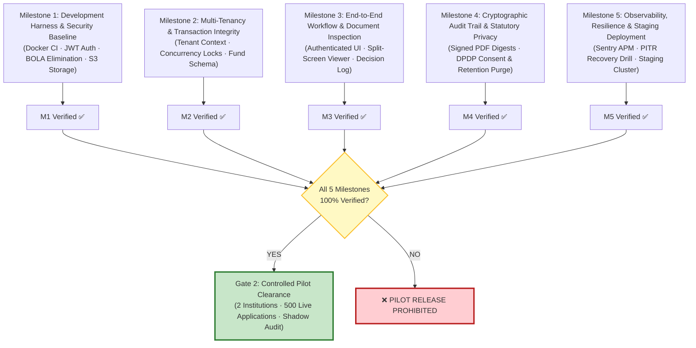

# FairExplain AI — Release Readiness Scorecard

**Document Version:** 1.1.0  
**Audit Date:** October 25, 2026  
**Auditor:** Senior Staff Software Engineer & Application Security Auditor  
**Repository:** `https://github.com/manthanshah/FairExplain-AI`

---

## 1. Formal Readiness Verdict by Stage

The release readiness of FairExplain AI is assessed against four progressive deployment stages. A stage is declared **READY** only when 100% of its mandatory verification criteria and release gates are satisfied with reproducible, evidence-backed proof.

```
+------------------------------------+----------------+-------------------------------------------------------+
| Deployment Stage                   | Status         | Summary Rationale                                     |
+------------------------------------+----------------+-------------------------------------------------------+
| 1. Ready to Begin Implementation   | **READY**      | Mathematical domain core is complete (70/70 unit tests|
|                                    |                | pass); database models and API routers provide solid  |
|                                    |                | foundations; implementation roadmap is established.   |
+------------------------------------+----------------+-------------------------------------------------------+
| 2. Ready for Internal Testing      | **NOT READY**  | Blocked by lack of server-side authentication (JWT),  |
|                                    |                | BOLA, and ephemeral local file storage (Milestone 1). |
+------------------------------------+----------------+-------------------------------------------------------+
| 3. Ready for Controlled Pilot      | **NOT READY**  | Unconditionally blocked until Milestones 1, 2, 3, 4,  |
|                                    |                | and 5 are 100% completed, tested, and signed off.     |
+------------------------------------+----------------+-------------------------------------------------------+
| 4. Ready for Commercial Production | **NOT READY**  | Blocked by SOC2 Type I compliance, 99.9% HA SLA,      |
|                                    |                | multi-region DR, and automated cloud OCR integration. |
+------------------------------------+----------------+-------------------------------------------------------+
```

---

## 2. Invariant Rule of Pilot Gate Clearance

> [!CRITICAL]
> **Mandatory Prerequisite Hierarchy for Gate 2 (Controlled Pilot):**
> No student data, live campus applicants, or institutional scholarship budgets may be ingested under any circumstances until **Gate 2** is formally unlocked.
> 
> **Formal Clearance Equation:**
> $$\text{Gate 2 Clearance} \iff \bigwedge_{i=1}^{5} \big(\text{Milestone } i \text{ Definition of Done} = \mathbf{VERIFIED}\big)$$
> 
> Bypassing any prerequisite milestone (e.g. attempting a pilot without Milestone 4 audit trail signing or Milestone 5 disaster recovery drill) is strictly prohibited.



---

## 3. The 6 Mandatory Pilot Release Blockers

| Blocker ID | Associated Gap ID | Description | Root Cause in Repository | Required Proof to Clear Blocker | Prerequisite Milestone | Status |
| :--- | :--- | :--- | :--- | :--- | :--- | :--- |
| **BLK-01** | `GAP-02-01` | **Zero Authentication on API Perimeter** | All routers in [`backend/app/routers/`](file:///Users/manthanshah/Documents/FairExplain/FairExplain-AI/backend/app/routers) lack auth dependencies; [`application_service.py:53`](file:///Users/manthanshah/Documents/FairExplain/FairExplain-AI/backend/app/services/application_service.py#L53) hardcodes `demo_hashed_password`. | Automated tests confirm unauthenticated requests to protected routes return HTTP 401; user registration hashes passwords with direct `bcrypt` (12 rounds). | Milestone 1 | **OPEN** |
| **BLK-02** | `GAP-02-03` | **Broken Object-Level Authorization (BOLA)** | [`GET /api/v1/application/{id}`](file:///Users/manthanshah/Documents/FairExplain/FairExplain-AI/backend/app/routers/applications.py#L44-L60) returns student records without checking requester identity; [`POST /admin/.../decision`](file:///Users/manthanshah/Documents/FairExplain/FairExplain-AI/backend/app/routers/admin.py#L60-L75) accepts arbitrary `reviewer_id`. | Automated security tests demonstrate that Student A querying Student B's UUID receives HTTP 403; non-reviewers cannot post decisions. | Milestone 1 | **OPEN** |
| **BLK-03** | `GAP-03-01` | **Ephemeral Local Document Storage** | [`LocalStorageBackend`](file:///Users/manthanshah/Documents/FairExplain/FairExplain-AI/backend/app/core/storage.py#L14-L46) stores uploaded marksheets on local disk (`./uploads`), causing total data loss on container restarts. | Documents upload directly to S3/R2 with KMS encryption; container restart test proves zero document loss; access via 15-min pre-signed URLs. | Milestone 1 | **OPEN** |
| **BLK-04** | `GAP-06-03` | **Concurrency Races on Scholarship Allocations** | No `EndowmentFund` model exists; multiple concurrent approvals can over-allocate institutional scholarship budgets beyond legal caps. | Integration test with 20 parallel workers confirms allocations halt precisely when budget reaches ₹0.00 using `with_for_update` row locks on `scholarship_funds`. | Milestone 2 | **OPEN** |
| **BLK-05** | `GAP-04-03` | **DPDP Act 2023 Statutory Non-Compliance** | Unencrypted national ID documents stored indefinitely without explicit student consent logging or automated retention purge. | Application submission logs immutable consent record; automated background worker deletes files from S3 after 180 days post-award. | Milestone 4 | **OPEN** |
| **BLK-06** | `GAP-07-02` | **Local Workstation Coupling in CI Integration Tests** | Integration test suite historically relied on a pre-existing local Postgres user rather than a containerized test harness. | `docker compose -f docker-compose.test.yml up --abort-on-container-exit` passes 100% in a clean, isolated environment in GitHub Actions. | Milestone 1 | **OPEN** |

---

## 4. Gate-by-Gate Verification Scorecard

### Gate 0: Development Baseline Gate
* **Objective:** Clean, reproducible builds, linting, and automated tests.
* **Status:** **PASS (Verified)**
* **Evidence:**
  - 92 backend tests pass in 1.73s (`pytest backend/tests`).
  - 13 frontend tests pass (`vitest run`).
  - Frontend production build succeeds cleanly in 226ms (`tsc -b && vite build`).
  - Git working tree is clean.

### Gate 1: Alpha / Security Remediation Gate
* **Objective:** Complete server-side authentication, authorization, and persistent S3 storage.
* **Prerequisite:** Completion and verification of **Milestone 1**.
* **Status:** **BLOCKED**
* **Blockers:** BLK-01, BLK-02, BLK-03, BLK-06.
* **Exit Requirement:** Passing OWASP ZAP baseline scan; automated security regression suite green; zero BOLA vulnerabilities.

### Gate 2: Institutional Pilot Release Gate
* **Objective:** Controlled deployment to 1–2 Higher Education Partner Institutions (500 applications).
* **Prerequisites:** 100% verification of **Milestones 1, 2, 3, 4, and 5**.
* **Status:** **BLOCKED**
* **Exit Requirements:**
  1. 100% mathematical concordance between deterministic engine calculations and institutional manual spreadsheet audit across 500 sample applications.
  2. Absolute programmatic isolation of LLM output: zero LLM mutations to calculated numbers or status booleans.
  3. Continuous API uptime during office hours (08:00 – 20:00 IST) ≥ 99.5% across 30 days.
  4. Written Pilot Acceptance Certificate signed by the Lead Financial Aid Officer (Partner University).

### Gate 3: Commercial General Availability (GA) Gate
* **Objective:** Public multi-tenant SaaS release with contractual enterprise SLAs.
* **Prerequisites:** Gate 2 exit + Milestone 7 completion.
* **Status:** **BLOCKED**
* **Blockers:** 34 GA items (SOC2 Type I, 99.9% HA SLA, automated cloud OCR, SIS connectors).
* **Exit Requirement:** External CREST penetration test sign-off; SOC2 Type I report; disaster recovery RTO < 60 min verified in live unannounced drill.
