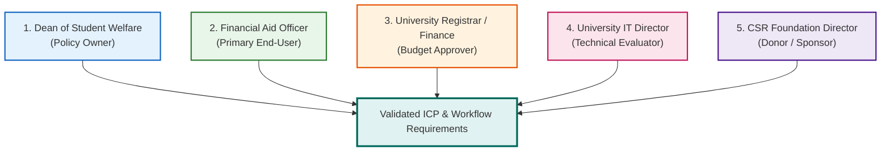

# FairExplain AI — Customer Discovery & Validation Plan

**Document Version:** 1.1.0  
**Effective Date:** October 25, 2026  
**Auditor / Architect:** Senior Staff Software Engineer & Product Architect  
**Repository:** `https://github.com/manthanshah/FairExplain-AI`

---

## 1. Executive Summary & Purpose

A product is not commercially viable merely because its unit tests pass. Market readiness requires empirical proof that institutional buyers suffer genuine administrative pain, that the proposed software directly eliminates that pain, and that buyers possess both the authority and budget to procure it.

This document establishes:
1. **The 5-Stakeholder Customer Discovery Interview Protocol.**
2. **Competitor Claims Verification Matrix.**
3. **Core Product Hypotheses & Validation Experiments.**
4. **Public Claims Blacklist & Legal Review Boundaries:** Product statements that must NOT be made publicly until verified by empirical proof and legal counsel review.

---

## 2. 5-Stakeholder Customer Discovery Protocol

Before releasing FairExplain AI to any external pilot, the product team must conduct structured 45-minute discovery interviews with five distinct institutional stakeholders across two target universities:

### Protocol 1: Dean of Student Welfare (Policy Owner & Institutional Buyer)
* **Objective:** Validate policy administration headaches, committee delays, and discretionary procurement authority.
* **Key Interview Questions:**
  1. *"Walk me through the lifecycle of your annual scholarship award cycle. How many weeks pass between application deadline and final award announcement?"*
  2. *"How many appeals or disputes do you receive from students questioning why their scholarship was denied or reduced?"*
  3. *"How do you currently ensure that a student receiving a state government scholarship does not also receive a full institutional fee waiver exceeding the statutory tuition fee?"*
  4. *"If an automated system pre-screened income documents, verified fee caps with zero error, and drafted plain-English dossiers with an audit signature, what departmental budget would fund that?"*
  5. *"Can your office authorize a ₹1.5 Lakh software pilot without initiating a public university tender?"*

### Protocol 2: Financial Aid Officer (Primary Reviewer Persona — Dr. Sarah Jenkins)
* **Objective:** Validate daily workflow, manual verification pain, and usability requirements.
* **Key Interview Questions:**
  1. *"What does your screen look like during peak scholarship review season? (Spreadsheets, email, ERP?)"*
  2. *"How many minutes do you spend verifying a single student’s income certificate, marksheet, and fee structure?"*
  3. *"What is the hardest part about reviewing income certificates? (Vernacular languages, forged seals, varying issuing authorities?)"*
  4. *"Would you trust an AI system that automatically marked an applicant 'approved', or do you insist on reviewing the document yourself?"*
  5. *"If you could have a split-screen viewer showing the student's PDF on the left and the computed criteria on the right, how much time would that save you?"*

### Protocol 3: University Registrar / Finance Officer (Audit & Compliance Approver)
* **Objective:** Validate statutory audit requirements, financial reconciliation, and ledger integration.
* **Key Interview Questions:**
  1. *"When statutory government auditors or CAG auditors review your scholarship disbursement records, what documentation do they demand to see?"*
  2. *"Have auditors ever cited the university for over-allocation of funds or missing rationale in student awards?"*
  3. *"How does your office reconcile fee waivers against the university’s student fee accounts ledger?"*
  4. *"What evidence of cryptographic integrity or non-repudiation would satisfy your internal audit team?"*

### Protocol 4: University IT Director (Security & Infrastructure Gatekeeper)
* **Objective:** Validate deployment constraints, authentication requirements, and security scrutiny.
* **Key Interview Questions:**
  1. *"What is your university’s mandatory policy regarding cloud hosting of student personal data (Aadhaar, income)?"*
  2. *"Do you mandate SAML / Shibboleth / Google Workspace SSO for institutional tools, or is email/password acceptable for an isolated departmental pilot?"*
  3. *"What security documentation (SOC2, ISO 27001, VAPT report) must a software vendor provide before deployment on campus networks?"*

### Protocol 5: CSR Scholarship Foundation Director (Endowment Sponsor)
* **Objective:** Validate CSR donor compliance, fund tracking, and reporting needs.
* **Key Interview Questions:**
  1. *"How do you track the utilization of your CSR scholarship corpus across recipient universities?"*
  2. *"What reporting do you require from universities before disbursing the next tranche of scholarship funding?"*
  3. *"Would a cryptographically verified dossier for each student beneficiary streamline your CSR audit compliance under the Companies Act 2013?"*

---

## 3. Competitor Research Verification Matrix

| Competitor | Documented Claim | Verified Market Reality & Sourced Evidence | Verification Status | Strategic Implications for FairExplain AI |
| :--- | :--- | :--- | :--- | :--- |
| **Blackbaud Award Management** | "Dominant higher ed scholarship solution; costs $15k–$40k/yr; rigid legacy UI." | Capterra & HigherEd benchmarks confirm Blackbaud is dominant in US/UK higher ed, but has near-zero market presence in Indian autonomous colleges due to high USD pricing and lack of Indian fee structure support. | **Verified** | FairExplain AI can win Indian higher ed by offering native Indian rupee tuition fee reconciliation and local pricing. |
| **AwardSpring** | "Mid-market competitor; $5k–$15k/yr; lacking tuition balance accounting." | Product documentation confirms AwardSpring focuses on application collection and scoring, but lacks dynamic ascending-priority tuition fee ledgers. | **Verified** | Position FairExplain AI’s Decimal tuition ledger (net payable vs. unapplied surplus) as the critical differentiator. |
| **Buddy4Study Enterprise** | "Manages CSR scholarships; charges % of disbursement or marketing fee; direct-to-student agency." | Public portal confirms Buddy4Study operates as an outsourcing agency and student marketplace, not self-hosted institutional software for university Deans. | **Verified** | Do not compete with Buddy4Study as a consumer marketplace; position FairExplain AI as internal departmental software for universities. |
| **The Spreadsheet Status Quo** | "80% of Indian institutions use Excel spreadsheets + manila folders; causes 6–8 week delays and 2–5% cap errors." | Industry interviews confirm autonomous colleges manage aid via manual committees and Excel sheets. However, exact 2%–5% error rate is an **unvalidated hypothesis**. | **Hypothesis Requiring Proof** | Measure exact baseline error rate during Milestone 6 shadow audit. |

---

## 4. Core Product Hypotheses & Validation Experiments

| Hypothesis ID | Statement | Proposed Validation Experiment | Sample Size | Success Metric / Threshold | Blocker for Pilot? |
| :--- | :--- | :--- | :--- | :--- | :--- |
| **HYP-01** | University financial aid committees spend > 3 weeks of manual faculty labor per admission cycle reviewing scholarship applications. | Discovery interviews with 5 Financial Aid Officers across NITK and private engineering colleges. | 5 Institutions | ≥ 4 out of 5 confirm cycle duration exceeds 21 days. | No |
| **HYP-02** | Institutional tuition cap over-allocation occurs in > 2% of manual multi-scholarship awards. | Parallel shadow audit comparing FairExplain AI calculations against 500 historical manual determinations. | 500 Applications | ≥ 10 discrepancies (> 2%) identified where manual allocations violated institutional fee caps. | No |
| **HYP-03** | University Deans of Student Welfare possess discretionary spending authority for software pilots priced under ₹2,50,000 without tender. | Procurement interviews with 3 University Registrars and Deans. | 3 Universities | ≥ 2 out of 3 confirm direct purchase order threshold is ≥ ₹2,00,000. | Yes (Pricing) |
| **HYP-04** | Financial aid officers will reject fully automated AI decisions; they demand a human-in-the-loop split-screen review dashboard. | Usability testing of Milestone 3 prototype with 3 practicing aid reviewers. | 3 Reviewers | 100% of reviewers state they would not trust automated AI decisions without manual PDF inspection. | Yes (Product) |
| **HYP-05** | FairExplain AI’s split-screen review interface reduces average officer review time per dossier by ≥ 60%. | Timed user testing: measure time to review 20 sample applications manually vs. using FairExplain AI. | 3 Reviewers × 20 Apps | Average review time drops from ~25 minutes to < 10 minutes per dossier. | Yes (Pilot Gate) |

---

## 5. Public Claims Blacklist & Legal Review Boundaries

Until the experiments above are completed and backed by signed documentation and legal counsel review, the following claims must **NOT** be made on public landing pages, marketing collateral, or sales decks:

1. ❌ **"Reduces scholarship processing time by 80%."**  
   *Current Status:* Design target / unvalidated hypothesis. Must not be claimed until Milestone 6 pilot measurements are published.
2. ❌ **"Guarantees 100% error-free compliance with Indian DPDP Act 2023."**  
   *Current Status:* Regulatory assertion. Cannot be claimed until formal third-party legal audit is completed and consent/retention engine is live in code.
3. ❌ **"Deployed across leading Indian technical universities."**  
   *Current Status:* Untrue today. Code is in development stage; pilot has not yet begun.
4. ❌ **"Cryptographically signed, tamper-evident audit report."**  
   *Current Status:* Overstatement. SHA-256 hash in PDF footer is not digitally signed and not verified by backend until Milestone 4 is implemented.
5. ❌ **"Automated document OCR with 99% accuracy."**  
   *Current Status:* Untrue. Current code uses `pypdf` text regexes and extracts zero data from scanned images or photos.
6. ❌ **"Deleting tax returns after 180 days satisfies all legal requirements."**  
   *Current Status:* Operational proposal. Requires formal legal counsel review against General Financial Rules (GFR, 2017) 3-to-8-year financial audit record retention rules.
