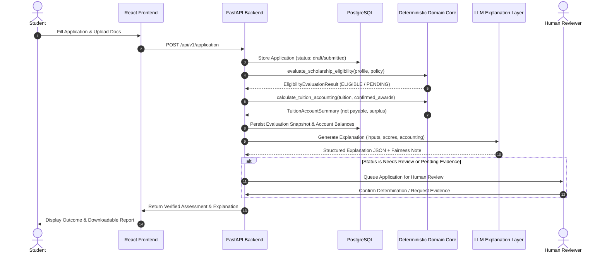

# System Architecture Specification

**Authoritative architectural specification for FairExplain AI: subsystem boundaries, layer responsibilities, data flow, and architectural invariants.**

---

## 1. System Overview & Component Topology

FairExplain AI employs a decoupled, multi-layered architecture designed for determinism, auditability, and clear separation of concerns:

```mermaid
flowchart TD
    subgraph ClientLayer ["1. Client Layer (Prototype Scaffolded)"]
        UI[React 18 + Vite + TypeScript<br/>Tailwind CSS & shadcn/ui]
        MockServices[Client API Services<br/>Currently backed by mock-data.ts]
        UI --> MockServices
    end

    subgraph APILayer ["2. API & Routing Layer (Scaffolded)"]
        FastAPIApp[FastAPI Bootstrap & Lifespan<br/>backend/app/main.py]
        HealthRouter[Health Router: /health<br/>Active & Operational]
        FeatureRouters[Feature Routers: /api/v1/*<br/>Scaffolded / Inactive]
        FastAPIApp --> HealthRouter
        FastAPIApp -.-> FeatureRouters
    end

    subgraph DomainCore ["3. Deterministic Domain Core (Phase 1B Merged & Tested)"]
        EligibilityEngine[Scholarship Eligibility Engine<br/>backend/app/domain/eligibility.py]
        AccountingEngine[Tuition Accounting Engine<br/>backend/app/domain/accounting.py]
        DomainModels[Immutable Models, Enums & Registry<br/>Pure Python / Zero External Dependencies]
        DomainModels --> EligibilityEngine
        DomainModels --> AccountingEngine
    end

    subgraph PersistenceLayer ["4. Persistence & Data Layer (Phase 1C Proposed)"]
        SQLAlchemyModels[SQLAlchemy 2 ORM Models<br/>backend/app/models/]
        AsyncDB[Async Engine & Session<br/>backend/app/db/database.py]
        PostgresDB[(PostgreSQL Database)]
        AlembicEnv[Alembic Migrations<br/>Migrations Pending Phase 1C]
        SQLAlchemyModels --> AsyncDB --> PostgresDB
    end

    subgraph AILayer ["5. Explainable AI Layer (Phases 4 & 5 Planned)"]
        LLMExplanation[LLM Explanation Service<br/>Gemini / OpenAI Structured Prompts]
        FairnessChecker[Fairness & Proxy Checker<br/>Audits for Indirect Bias]
        LLMExplanation --> FairnessChecker
    end

    subgraph Governance ["6. Human-in-the-Loop Governance"]
        ReviewerQueue[Review Queue & Determination]
        FinalReport[Audit Report & PDF]
        ReviewerQueue --> FinalReport
    end

    MockServices -.->|HTTP / REST (Planned)| FeatureRouters
    FeatureRouters -.->|Service Adapters| DomainCore
    FeatureRouters -.->|Repositories| PersistenceLayer
    DomainCore -->|Output Telemetry| LLMExplanation
    FairnessChecker --> ReviewerQueue
```

---

## 2. Implementation Status by Architectural Subsystem

| Subsystem | Source Location | Implementation Status | Notes |
|---|---|---|---|
| **Deterministic Domain Core** | `backend/app/domain/` | **Implemented & Tested** | Pure Python 3.10+, zero external dependencies. **40 unit tests passing** via standard library `unittest`. |
| **API Application Scaffold** | `backend/app/main.py` | **Scaffolded** | Structured logging, middleware, CORS, lifespan, and operational `/health` endpoint. |
| **Feature Routers** | `backend/app/api/router.py` | **Scaffolded / Inactive** | Routers for `/auth`, `/application`, `/scholarship`, `/loan` are defined but commented out pending integration. |
| **ORM Models** | `backend/app/models/` | **Scaffolded** | Initial declarative models exist; alignment with Phase 1B domain contracts is proposed for Phase 1C. |
| **Database Migrations** | `backend/alembic/` | **Scaffolded / No Revisions** | Migration infrastructure is configured; revision generation is part of Phase 1C. |
| **Frontend Client** | `frontend/src/` | **Prototype Scaffolded** | React + TypeScript client with dashboard, application form, and results UI backed by synthetic mock data. |
| **OCR Service** | N/A | **Planned** | Server-side document upload, extraction, and mismatch cross-checking planned for Phase 3. |
| **LLM Explanation Service** | `docs/PROMPTS.md` | **Designed / Planned** | Prompt contract and JSON output schema specified; backend service integration planned for Phase 4. |
| **Fairness Checker** | `docs/RULE_ENGINE.md` | **Designed / Planned** | Proxy-attribute screening rules defined; runtime screening planned for Phase 5. |

---

## 3. Core Architectural Invariants

The following architectural rules are non-negotiable across all present and future phases:

### 3.1 Domain Decoupling & Purity
- `backend/app/domain/` has **zero external dependencies**.
- The domain layer must never import web frameworks (`fastapi`, `starlette`), ORMs (`sqlalchemy`), serialization tools (`pydantic`), or AI libraries.
- All monetary arithmetic in the domain layer uses `Decimal`, finite validation, and `ROUND_HALF_UP` quantization (`0.01`).

### 3.2 Authority & Responsibility Boundaries
- **Calculations**: Owned exclusively by the deterministic Python domain core. AI models **never** calculate eligibility, award amounts, tuition reductions, or affordability scores.
- **Explanations**: The AI layer translates pre-computed domain outputs into plain English. It cannot override, modify, or infer missing financial or academic facts.
- **Final Decisions**: The system produces decision-support evaluations and explainable recommendations. Authorized human reviewers (university financial aid officers or bank underwriters) retain sole legal and operational authority.

### 3.3 Evidence & Failure Semantics
- Missing or unverified supporting documents must result in `PENDING_EVIDENCE`, never a failed criterion.
- OCR extraction is not verification. Extracted data requires verification against self-reported attributes before transitioning evidence status.

### 3.4 Financial Integrity & Surplus
- Only confirmed awards (`AwardStatus.CONFIRMED`) reduce payable tuition.
- Award allocations must follow strict unique positive integer priorities (`priority >= 1`).
- Remaining payable tuition and institutional waiver allowances are tracked independently.
- Unapplied surplus is tracked for accounting transparency and is never treated as cash, living allowances, or cash refunds.

---

## 4. End-to-End Data Flow (Target Architecture)



---

## 5. Security & Privacy Architecture

1. **Server-Side AI Credential Isolation**: AI provider credentials (Gemini / OpenAI API keys) and database credentials are stored in server-side environment variables and never exposed to the frontend.
2. **PII Protection & Encryption**: Uploaded identity and financial documents must be encrypted at rest in cloud object storage; personal data is processed strictly within backend boundaries.
3. **Immutable Audit Logging**: Every domain evaluation, explanation generation pass, fairness flag, and human review action is recorded in an immutable audit log (`AuditLogEntry`).
