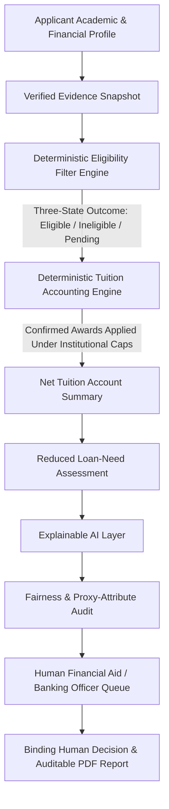

# Domain Context & Problem Framing

**Comprehensive problem statement, educational financing background, and solution architecture rationale for FairExplain AI.**

---

## 1. Background: The Educational Financing Divide

In higher education financing—particularly across emerging economies such as India—prospective students navigate two entirely disconnected institutional processes:
1. **Scholarship Applications**: Managed by universities, government departments, charitable endowments, and private trusts, typically operating on fragmented eligibility cycles.
2. **Education Loan Applications**: Underwritten by banks and non-banking financial companies (NBFCs), focused almost exclusively on credit risk, existing household debt, and collateral.

In practice, these two systems operate as parallel silos. Students rarely understand how a potential scholarship award interacts with their loan requirements. Consequently, students often borrow significantly more than necessary—accumulating high-interest debt—or abandon educational opportunities because initial tuition fees appear insurmountable.

---

## 2. Core Problem Drivers

```
┌──────────────────────────────────────────────┐
│                  THE DIVIDE                  │
├──────────────────────┬───────────────────────┤
│ Scholarship Silo     │ Education Loan Silo   │
├──────────────────────┼───────────────────────┤
│ • Scattered criteria │ • Opaque rejection    │
│ • Unknown timelines  │ • High-interest debt  │
│ • Hidden waiver caps │ • Ignores scholarships│
└──────────────────────┴───────────────────────┘
```

1. **Information Asymmetry & Opaque Outcomes**: Loan denials and scholarship rejections are frequently issued as binary, uninformative decisions without actionable explanations.
2. **Disconnected Calculations**: No unified platform exists to compute post-scholarship net tuition balances before initiating loan underwriting.
3. **Complex Policy Constraints**: Institutional tuition-waiver caps, program-level limits, and award exclusivity rules create confusion regarding the actual out-of-pocket tuition payable.
4. **Erosion of Trust in Automated Systems**: Black-box scoring algorithms create valid concerns regarding bias, unfair demographic proxies, and lack of accountability.

---

## 3. FairExplain AI Solution Rationale

FairExplain AI unites scholarship screening and tuition accounting as a **deterministic precursor** to education loan evaluation, enveloped in an explainability and human-governance framework:



---

## 4. Architectural Tenets & Responsible AI

1. **Deterministic Domain Core Owns All Numbers**: All eligibility determinations, award caps, and tuition balances are computed by pure Python deterministic algorithms. Artificial intelligence models never calculate scores or alter mathematical balances.
2. **The AI Recommends; The Human Decides**: The platform operates strictly as a decision-support assistant. No automated, binding legal or financial determination is made without authorized human review.
3. **Evidence Integrity**: Missing supporting documentation places an assessment into `PENDING_EVIDENCE`, preventing premature or unfair rejections.
4. **Proxy Neutrality**: The system strictly screens against demographic proxies (e.g., geographic postal codes, surnames) to prevent indirect bias from influencing explanations or recommendations.
5. **Auditable Reproducibility**: Frozen evaluation snapshots guarantee that any historical assessment can be mathematically and logically reproduced years later.
