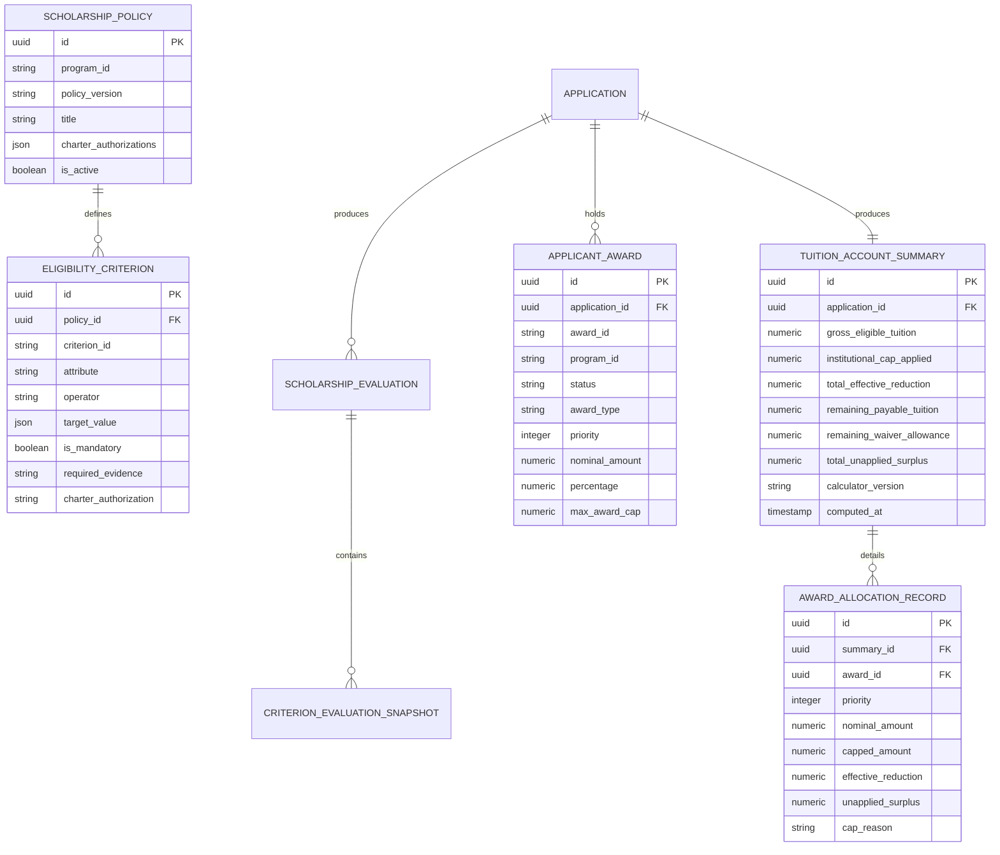

# Data Model Specification

**Specification of database entities, existing SQLAlchemy 2 models, domain-contract gaps, and the proposed Phase 1C persistence design.**

---

## 1. Current State & Verification Summary

The database layer currently contains initial scaffold models in `backend/app/models/`, configured with SQLAlchemy 2 declarative syntax. Database migrations are not yet initialized (`backend/alembic/versions/` contains only `.gitkeep`).

| Model Category | Current Implementation State | Notes |
|---|---|---|
| **Core Entity Scaffold** | **Scaffolded in `backend/app/models/`** | `User`, `Application`, `AcademicRecord`, `FinancialProfile`, `UploadedDocument`, `AuditLogEntry`. |
| **Legacy Assessment Scaffold** | **Scaffolded in `backend/app/models/`** | `ScholarshipAssessment`, `LoanAssessment`, `ExplanationReport` (represent initial prototype schema). |
| **Domain Policy Persistence** | **Not Implemented** | No models currently exist for versioned scholarship policies, criteria catalogs, or charter authorizations. |
| **Award & Accounting Persistence** | **Not Implemented** | No models currently exist for multi-award lifecycle tracking, tuition accounts, or surplus allocation. |
| **Alembic Migration History** | **Empty (No Revisions)** | Baseline migration is part of the proposed Phase 1C milestone. |

---

## 2. Existing Scaffold Models (`backend/app/models/`)

These models exist in the repository and inherit from `UUIDPrimaryKeyMixin`, `TimestampMixin`, and declarative `Base` (`backend/app/db/base.py`).

### 2.1 User (`backend/app/models/user.py`)
- `id`: UUID (Primary Key)
- `email`: String(255), Unique, Indexed
- `full_name`: String(255)
- `role`: Enum (`student`, `university`, `bank`, `scholarship_provider`, `admin`)
- `is_active`: Boolean (default True)
- `created_at`, `updated_at`: DateTime (UTC)

### 2.2 Application (`backend/app/models/application.py`)
- `id`: UUID (Primary Key)
- `user_id`: UUID (Foreign Key → `users.id`, ondelete="CASCADE")
- `status`: Enum (`draft`, `submitted`, `needs_review`, `ready_for_report`, `closed`)
- `created_at`, `updated_at`: DateTime (UTC)

### 2.3 AcademicRecord (`backend/app/models/academic_record.py`)
- `id`: UUID (Primary Key)
- `application_id`: UUID (Foreign Key → `applications.id`, Unique)
- `cgpa`: Numeric(4, 2) (0.00 – 10.00)
- `tenth_percent`: Numeric(5, 2) (0.00 – 100.00)
- `twelfth_percent`: Numeric(5, 2) (0.00 – 100.00)
- `backlogs`: Integer (Active backlogs count)

### 2.4 FinancialProfile (`backend/app/models/financial_profile.py`)
- `id`: UUID (Primary Key)
- `application_id`: UUID (Foreign Key → `applications.id`, Unique)
- `household_income`: Numeric(14, 2) (INR/year)
- `existing_emi`: Numeric(14, 2) (INR/month)
- `tuition_fee`: Numeric(14, 2) (INR/year)
- `requested_loan`: Numeric(14, 2) (INR)

### 2.5 UploadedDocument (`backend/app/models/uploaded_document.py`)
- `id`: UUID (Primary Key)
- `application_id`: UUID (Foreign Key → `applications.id`)
- `doc_type`: Enum (`marksheet`, `income_proof`, `id_proof`)
- `file_url`: String(1024)
- `ocr_extracted_data`: JSON
- `mismatch_flag`: Boolean (default False)

### 2.6 Legacy Assessment Scaffold Models
- **`ScholarshipAssessment` (`scholarship_assessment.py`)**:
  - `application_id`: UUID (Foreign Key → `applications.id`, Unique)
  - `scholarship_percent`: Numeric(5, 2)
  - `scholarship_amount`: Numeric(14, 2)
  - `outcome`: Enum (`Eligible`, `Needs Review`, `Not Recommended`)
  - `rule_engine_version`: String(50)
- **`LoanAssessment` (`loan_assessment.py`)**:
  - `application_id`: UUID (Foreign Key → `applications.id`, Unique)
  - `reduced_loan_amount`: Numeric(14, 2)
  - `outcome`: Enum (`Eligible`, `Needs Review`, `Not Recommended`)
  - `confidence`: Numeric(5, 2)
  - `rule_engine_version`: String(50)
- **`ExplanationReport` (`explanation_report.py`)**:
  - `assessment_type`: Enum (`scholarship`, `loan`)
  - `assessment_id`: UUID
  - `recommendation_text`: Text
  - `reasons`: JSON
  - `confidence_note`: Text
  - `fairness_note`: Text
  - `llm_prompt_version`: String(50)
- **`AuditLogEntry` (`audit_log.py`)**:
  - `application_id`: UUID (Foreign Key → `applications.id`)
  - `event_type`: Enum (`score_computed`, `explanation_generated`, `fairness_flag`, `human_review_action`)
  - `detail`: JSON

---

## 3. Discrepancy & Gap Analysis (Scaffold vs. Phase 1B Domain Contracts)

The Phase 1C architectural audit identified the following critical gaps between the current scaffold models and the merged Phase 1B domain contracts:

1. **Policy & Criteria Catalog**:
   - The scaffold models contain no representation of `ScholarshipPolicy` or `EligibilityCriterion`.
   - Criteria operators (`EQ`, `GT`, `IN`, etc.), target values, mandatory flags, evidence requirements, and sensitive attribute charter authorizations cannot currently be persisted.
2. **Eligibility Evaluation Granularity**:
   - `ScholarshipAssessment` stores a single percentage and amount, with outcome states (`Eligible`, `Needs Review`, `Not Recommended`).
   - Phase 1B domain contracts require criterion-level evaluation breakdown (`CriterionEvaluation`), three-state outcomes (`ELIGIBLE`, `INELIGIBLE`, `PENDING_EVIDENCE`), and frozen attribute snapshots for reproducibility.
3. **Award Lifecycle & Multi-Award Tracking**:
   - The scaffold lacks an `AwardSpecification` entity.
   - Statuses (`CONFIRMED`, `ELIGIBLE`, `PROVISIONALLY_AWARDED`, etc.), priority ranks (strictly unique positive integers), and program-level caps cannot currently be persisted.
4. **Tuition Accounting Balances**:
   - The scaffold has no representation of `TuitionAccountSummary` or `AwardAllocationResult`.
   - Cannot persist gross tuition, institutional caps applied, total effective reductions, remaining payable tuition, remaining waiver allowance, or unapplied surplus breakdowns.
5. **Alembic Revisions**:
   - No migration scripts exist in `backend/alembic/versions/`.

---

## 4. Proposed Phase 1C Persistence Design

> **Note:** The following schema design is **proposed and awaiting explicit implementation approval** under Phase 1C. It is not currently implemented in the database.

### 4.1 Key Persistence Guarantees Planned for Phase 1C
- **Historical Reproducibility**: Frozen JSON snapshots of evaluation inputs, criterion outcomes, and policy versions ensure assessments can be audited years later without data drift.
- **Strict Decimal Precision**: Numeric columns for monetary amounts enforce `Numeric(14, 2)`, matching the `Decimal('0.01')` domain arithmetic.
- **Referential Integrity**: Cascading deletes or archival flags on applications protect historical audit records.
