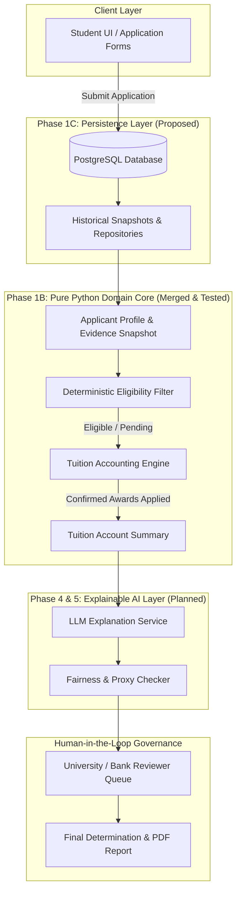

# FairExplain AI — Documentation Hub

**Comprehensive technical documentation, architecture specifications, and implementation guidelines for FairExplain AI.**

This directory contains the authoritative specifications for the platform. For general project overview and quickstart instructions, refer to the root [README.md](../README.md).

---

## 1. Documentation Index

| Document | Primary Audience | Description |
|---|---|---|
| [PROJECTCONTEXT.md](./PROJECTCONTEXT.md) | **AI Coding Agents & Developers** | Single source of truth for architectural constraints, non-negotiable rules, coding standards, and project context. |
| [ROADMAP.md](./ROADMAP.md) | **Project Team & Reviewers** | Phased development plan, verified implementation status, exit criteria, and release milestones. |
| [RULE_ENGINE.md](./RULE_ENGINE.md) | **Domain Specialists & Backend Engineers** | Specifications for the Phase 1B deterministic eligibility filter, tuition accounting engine, and future scoring models. |
| [ARCHITECTURE.md](./ARCHITECTURE.md) | **System Architects & Engineers** | Multi-layer architecture, zero-dependency domain boundaries, request lifecycle, and deployment topology. |
| [DATA_MODEL.md](./DATA_MODEL.md) | **Backend & Database Engineers** | Data dictionaries, entity relationships, existing scaffold models, and the proposed Phase 1C persistence design. |
| [SRS.md](./SRS.md) | **Product, QA & Compliance** | Software Requirements Specification, functional/non-functional requirements, and traceability. |
| [PRD.md](./PRD.md) | **Product Managers & Stakeholders** | Product vision, user personas, problem framing, and success metrics. |
| [PROMPTS.md](./PROMPTS.md) | **AI Engineers & LLM Developers** | LLM prompt specification, input contracts, JSON output schemas, and fairness guardrails. |
| [CONTEXT.md](./CONTEXT.md) | **All Contributors** | Domain background, financing landscape analysis, and solution rationale. |

---

## 2. High-Level System Architecture & Workflow

---

## 3. Technology Stack Summary

| Subsystem | Components | Current Repository State |
|---|---|---|
| **Domain Core** | Pure Python 3.10+, Decimal math, standard library dataclasses/enums | **Implemented & Tested** (`backend/app/domain/`), 40/40 unit tests passing |
| **Backend Scaffold** | FastAPI, Pydantic v2, Python logging, async lifespan | **Scaffolded** (`backend/app/main.py`), `/health` operational |
| **Database & ORM** | PostgreSQL, SQLAlchemy 2 (async), Alembic | **Scaffolded** (`backend/app/models/`, `backend/alembic/`), no migration revisions yet |
| **Frontend Client** | React 18, Vite, TypeScript, Tailwind CSS, shadcn/ui, TanStack Query | **Prototype Scaffolded** (`frontend/src/`), uses mock data |
| **AI & Explainability** | Structured JSON prompts (Gemini/OpenAI), Fairness Checker | **Designed / Planned** (Contracts defined in `PROMPTS.md`) |
| **Document Processing**| Server-side OCR extraction, cross-verification against self-reported data | **Planned** |

---

## 4. Documentation Governance

1. **Source Code is Authoritative**: Documentation must accurately reflect what is implemented in the repository. Do not document planned or proposed features as implemented.
2. **Clear Status Labels**: Maintain clear distinctions between:
   - *Implemented and Tested*
   - *Scaffolded (Present but not fully integrated)*
   - *Proposed / Designed (Under review)*
   - *Planned (Future phases)*
3. **No Unilateral Architecture Changes**: Major changes to domain boundaries, arithmetic rounding rules, or sensitive attribute policies require explicit review.
4. **Maintenance Responsibility**: When completing a development milestone, update the corresponding specifications in this directory, the root [README.md](../README.md), and [ROADMAP.md](./ROADMAP.md).
