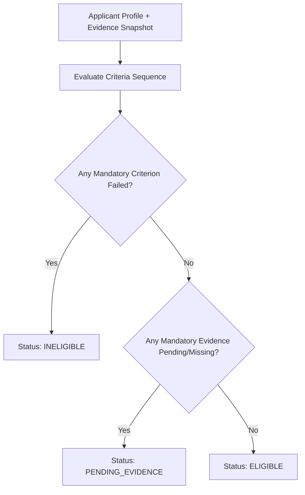

# Deterministic Domain Logic Specification

**Authoritative specification for the FairExplain AI deterministic domain core: scholarship eligibility filtering, tuition accounting, and planned loan affordability scoring.**

---

## 1. Domain Philosophy & Architecture

The domain layer is the single source of truth for all business evaluations, eligibility determinations, and financial calculations within FairExplain AI.

### Core Domain Principles
1. **Strict Determinism**: Identical inputs, policies, and parameters produce identical mathematical and logical results every time. No stochastic processes, ML models, or external inferences exist in the calculation path.
2. **Zero External Dependencies**: The domain core (`backend/app/domain/`) is implemented in pure Python 3.10+ using standard library modules (`dataclasses`, `enum`, `decimal`, `typing`). It is decoupled from web frameworks (FastAPI), ORMs (SQLAlchemy), and AI APIs.
3. **Filtering vs. Ranking Separation**: Eligibility filtering is distinct from merit ranking. Eligibility establishes binary qualification (`ELIGIBLE`, `INELIGIBLE`, `PENDING_EVIDENCE`). Ranking orders candidates within an eligible pool. Phase 1B implements deterministic eligibility filtering; ranking is planned for a subsequent milestone.
4. **Finite Monetary Precision**: All financial arithmetic is performed using Python's `Decimal` type with explicit finite-value validation and `ROUND_HALF_UP` rounding to two decimal places (`0.01`). Floating-point arithmetic and booleans are strictly rejected.

---

## 2. Implemented: Scholarship Eligibility Filter Engine

Implemented in `backend/app/domain/eligibility.py` and models in `backend/app/domain/models.py`.

### 2.1 Evaluation Workflow
The eligibility filter evaluates an `ApplicantProfile` against an institution-configured `ScholarshipPolicy` containing a sequence of `EligibilityCriterion` rules:



### 2.2 Three-State Eligibility Outcomes
| Outcome | Definition | System Action |
|---|---|---|
| **`ELIGIBLE`** | All mandatory criteria are satisfied and all required evidence is verified. | Eligible for award consideration; proceeds to tuition accounting if confirmed. |
| **`INELIGIBLE`** | One or more mandatory criteria failed evaluation. | Ineligible; detailed failure reasons recorded in evaluation report. |
| **`PENDING_EVIDENCE`** | No mandatory criterion failed, but one or more criteria require supporting evidence that is unverified or missing. | Application held in pending state; student prompted for required documents. |

> **Critical Rule**: Missing or unverified evidence must **never** be treated as a failed criterion.

### 2.3 Mandatory vs. Optional Criteria
- **Mandatory Criteria (`is_mandatory=True`)**:
  - Failure results in overall `INELIGIBLE` status.
  - Pending evidence results in overall `PENDING_EVIDENCE` status (unless a mandatory criterion has already failed).
- **Optional Criteria (`is_mandatory=False`)**:
  - Used for informational checks, preferred qualifications, or tie-breaking signals.
  - Failure or pending evidence does **not** alter the overall eligibility status.

### 2.4 Comparison Operators
Criteria support the following comparison operators (`CriterionOperator`):
- Equality / Inequality: `EQ` (`==`, `eq`, `equals`), `NEQ` (`!=`, `neq`, `not_equals`)
- Relational: `GT` (`>`), `GTE` (`>=`), `LT` (`<`), `LTE` (`<=`)
- Set Inclusion: `IN` (`in`), `NOT_IN` (`not_in`) (target value must be a sequence/collection)

Numeric comparisons automatically convert compatible string, integer, float, and Decimal representations to `Decimal` for exact arithmetic comparison.

### 2.5 Attribute Registry & Purpose Governance
All criteria attributes must exist in the canonical `SUPPORTED_ATTRIBUTES` registry. Any unknown, misspelled, or unregistered attribute raises `UnsupportedAttributeError`.

Attributes are classified by permitted purpose (`AttributePurpose`):
1. **`MERIT_RANKING`**: Academic performance metrics (`cgpa`, `tenth_percent`, `twelfth_percent`, `active_backlogs`, `coursework_score`).
2. **`PROGRAM_ELIGIBILITY`**: Need, residency, and program alignment attributes (`household_income`, `family_size`, `state_of_domicile`, `programme_enrolled`, `department`, `institution_id`, `first_generation_college`).
3. **`RESTRICTED_SENSITIVE`**: Protected demographic attributes (`caste_category`, `caste`, `gender`, `religion`, `disability_status`).

#### Sensitive Attribute Governance
- Sensitive attributes are strictly prohibited from general merit ranking or unapproved filtering.
- A sensitive attribute may only be evaluated if the criterion or policy contains an explicit, non-empty **`charter_authorization`** reference (e.g., legislation reference, trust deed, or institutional endowment charter order).
- Attempting to evaluate a sensitive attribute without a valid charter reference raises `DisallowedAttributeError`.
- *Note: Charter authorization is an internal technical governance constraint; it does not declare or substitute for legal compliance.*

---

## 3. Implemented: Tuition Accounting Engine

Implemented in `backend/app/domain/accounting.py` and models in `backend/app/domain/models.py`.

### 3.1 Accounting Function Signature
```python
def calculate_tuition_accounting(
    gross_eligible_tuition: Decimal | int | float | str,
    awards: Sequence[AwardSpecification],
    institutional_cap: InstitutionalCap | None = None,
) -> TuitionAccountSummary
```

### 3.2 Award Status & Confirmation Requirement
Only awards with lifecycle status **`AwardStatus.CONFIRMED`** reduce actual tuition payable. Awards in other lifecycle states (`ELIGIBLE`, `APPLIED`, `PENDING`, `PROVISIONALLY_AWARDED`, `REJECTED`) are recorded in `unconfirmed_awards` and do not reduce payable tuition.

### 3.3 Explicit Priority & Allocation Order
- Every confirmed award must specify a strictly positive integer priority (`priority >= 1`).
- Missing priority raises `MissingAwardPriorityError`.
- Tied priorities among confirmed awards raise `TiedAwardPriorityError`.
- Confirmed awards are allocated strictly in ascending priority order (`1` = highest priority).

### 3.4 Incompatible Awards
Awards can declare `incompatible_programs`. If multiple confirmed awards share mutual exclusivity, the engine raises `IncompatibleAwardsError`.

### 3.5 Award Types & Program Caps
1. **Fixed Amount (`AwardType.FIXED_AMOUNT`)**: Specifies a discrete monetary amount (`amount`).
2. **Percentage of Tuition (`AwardType.PERCENTAGE_OF_TUITION`)**: Specifies a percentage (`percentage`) computed against `gross_eligible_tuition`.
3. **Program Cap (`max_award_cap`)**: Optional upper ceiling per award; `capped_amount = min(nominal_amount, max_award_cap)`.

### 3.6 Institutional Waiver Caps
Institutions can configure an `InstitutionalCap`:
- Fixed cap: `max_waiver_amount`
- Percentage cap: `max_waiver_percentage`
- If both are defined, the **tighter (lower) cap** applies.
- If neither is configured, the waiver allowance equals `gross_eligible_tuition`.

### 3.7 Independent Balance & Surplus Tracking
The accounting engine maintains two independent running balances:
1. **`remaining_payable_tuition`**: Current payable tuition balance owed by the student (starts at `gross_eligible_tuition`).
2. **`remaining_waiver_allowance`**: Current institutional waiver room remaining under the institutional cap.

For each confirmed award:
$$\text{effective\_reduction} = \min(\text{capped\_amount}, \text{remaining\_payable\_tuition}, \text{remaining\_waiver\_allowance})$$
$$\text{unapplied\_surplus} = \text{capped\_amount} - \text{effective\_reduction}$$

Balances are decremented by $\text{effective\_reduction}$ after each allocation.

#### Surplus Semantics
- `total_unapplied_surplus` reflects the award value that could not be applied due to zero payable balance or institutional caps.
- **Unapplied surplus is never cash, never a living-expense stipend, and never a refund to the student.**

---

## 4. Planned: Scoring & Affordability Models (Subsequent Phases)

The following models represent planned extensions for subsequent milestones and are **not** part of the Phase 1B merge.

### 4.1 Merit-Based Weighted Scoring (Planned)
For competitive ranking within an eligible applicant cohort:
$$\text{Merit Score} = (0.40 \times \text{CGPA}_{\text{norm}}) + (0.20 \times \text{Twelfth}_{\%}) + (0.30 \times \text{Need Score}) + (0.10 \times \text{Backlog Penalty})$$

### 4.2 Loan Affordability Check (Planned)
Assesses the student's ability to service the required education loan on the **reduced loan amount** (post-scholarship):
$$\text{Available Monthly Capacity} = \left(\frac{\text{Household Income}}{12}\right) \times 0.40 - \text{Existing EMI}$$
$$\text{Estimated EMI} = \frac{\text{Remaining Loan Amount}}{\text{Tenure Months}}$$

Outcome recommendations:
- `Eligible`: Estimated EMI $\le$ Available Monthly Capacity.
- `Needs Review`: Estimated EMI exceeds capacity by $\le 20\%$, or document mismatches exist.
- `Not Recommended`: Estimated EMI exceeds capacity by $> 20\%$.

---

## 5. Reproducibility & Audit Trail Requirements

Every assessment and accounting result must be permanently reproducible:
1. Frozen inputs snapshot (applicant attributes and verified evidence at evaluation time).
2. Immutable policy version string and cryptographic checksum.
3. Calculator engine version string (e.g., `1.0.0-phase1b`).
4. Fixed decimal precision and rounding configuration (`Decimal('0.01')`, `ROUND_HALF_UP`).
