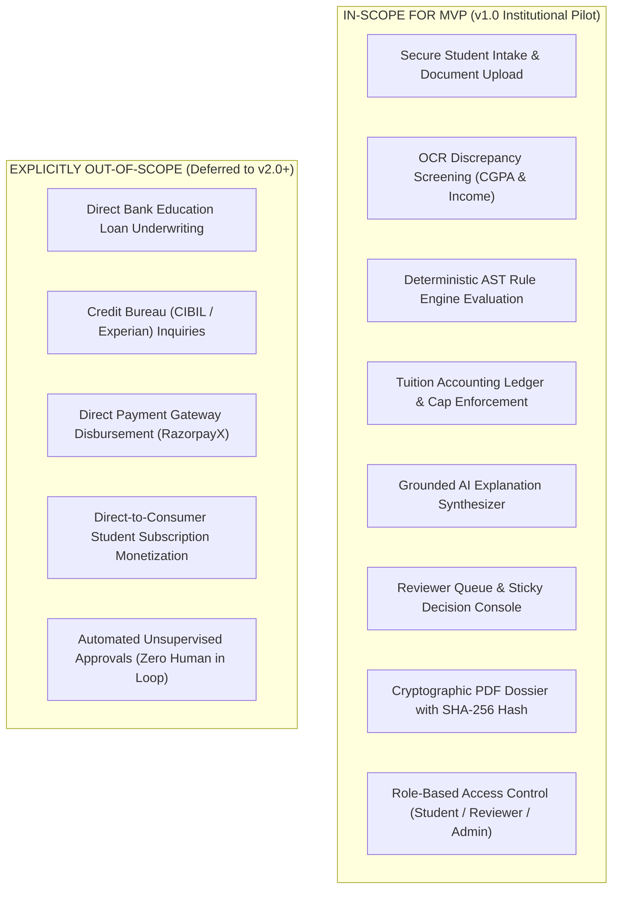
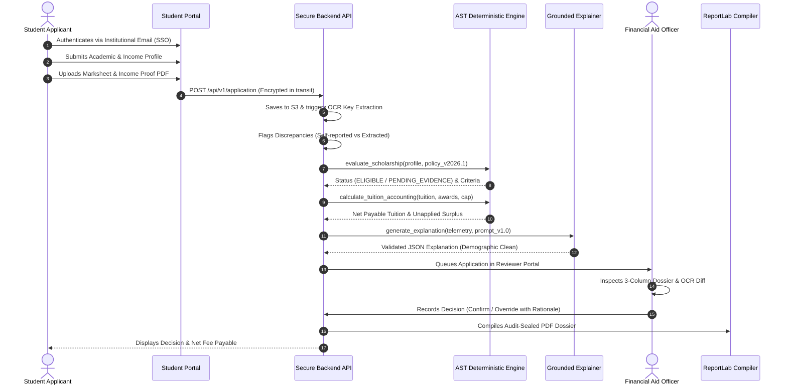

# FairExplain AI — Product Requirements Specification (PRD v2.0)

**Document Status:** Proposed Target Specification for Production MVP  
**Target Release:** v1.0 Enterprise Pilot Release  
**Author:** Product & Systems Architecture Team  
**Audience:** Engineering, Product, Institutional Sales, Compliance Officers  

---

## 1. Problem Statement & Value Proposition

### 1.1 The Institutional Problem
Higher Education Institutions (HEIs) and Corporate Social Responsibility (CSR) Foundations manage complex scholarship portfolios (Merit-cum-Means aid, endowment scholarships, state welfare waivers). Currently, this process suffers from three severe operational pain points:
1. **Administrative Verification Paralysis:** A university receiving 3,000–8,000 annual scholarship applications spends 6 to 8 weeks manually reviewing marksheets, state income certificates (issued by Tehsildars), and tax filings. Physical paperwork or disorganized PDF uploads lead to backlogs, lost files, and delayed semester tuition disbursements.
2. **Tuition Cap & Accounting Errors:** Students frequently receive multiple awards from disparate departments or external trusts. Applying awards without strict priority ordering or exceeding institutional fee caps results in accounting deficits, cash refund disputes, or compliance audit flags by statutory bodies (e.g., Comptroller and Auditor General / UGC / NAAC audits).
3. **Legal & Compliance Exposure under DPDP Act 2023:** Storing unencrypted student tax records and identity documents on shared departmental drives or emailing marksheets creates catastrophic exposure under India’s Digital Personal Data Protection (DPDP) Act 2023, where personal data breaches carry statutory penalties of up to ₹250 crore.

### 1.2 The Value Proposition
> **For Higher Education Aid Officers and Scholarship Foundations, FairExplain AI is an auditable, deterministic decision-support platform that cuts application verification time from 6 weeks to 72 hours, eliminates tuition ledger allocation errors, and produces tamper-evident, explainable dossiers where human officers retain 100% legal authority.**

Unlike opaque AI chatbots or rigid enterprise ERP modules (e.g., generic SAP / PeopleSoft / Ellucian add-ons), FairExplain AI guarantees that **math is 100% deterministic (zero AI calculations)**, explanations are strictly grounded in statutory rules without demographic bias, and every decision is sealed with a cryptographic SHA-256 audit digest.

---

## 2. Target Personas & Stakeholder Dynamics

```
+----------------------------------------------------------------------------------------------------+
|                                    STAKEHOLDER ECOSYSTEM                                           |
+--------------------------+------------------------------+------------------------------------------+
| Stakeholder Role         | Persona & Title              | Core Motivation & Buying Power           |
+--------------------------+------------------------------+------------------------------------------+
| Economic Buyer           | Dean of Student Welfare /    | Eliminates audit liabilities, accelerates|
| (Signs the Contract)     | Registrar / CFO              | fee collection, ensures NAAC compliance. |
| Primary User             | Financial Aid Officer /      | Eliminates manual spreadsheet auditing,  |
| (Daily Workhorse)        | Scholarship Committee Member | automates OCR checks, manages queue.     |
| Beneficiary / Submitter  | Undergraduate / Postgraduate | Transparent criteria checklist, clear    |
| (Applicant)              | Student Applicant            | remaining tuition fee, zero mystery.     |
| Compliance Auditor       | Institutional Internal       | Complete cryptographic reproducibility,  |
| (Inspects the Record)    | Auditor / UGC Inspector      | immutable policy version checksums.      |
+--------------------------+------------------------------+------------------------------------------+
```

### Primary Persona: Dr. Sarah Jenkins (Senior Financial Aid Officer)
* **Demographics:** 42 years old; 12 years in university administration; oversees ₹8.5 crore in annual endowment and merit-need disbursements.
* **Pain Points:** Drowning in spreadsheet reconciliation; terrified of approving a student whose family income actually exceeded the statutory ₹8,00,000 ceiling due to forged income certificates; frustrated by students asking why their application was rejected.
* **Job-to-be-Done:** *"When the scholarship window closes, I want to quickly verify whether 4,000 applicants meet policy criteria, see exact document discrepancy flags, and generate an audited award determination that my Vice-Chancellor and auditors will sign without question."*

---

## 3. Product Scope: In-Scope vs. Explicitly Out-of-Scope



---

## 4. End-to-End User Journey



---

## 5. Functional Requirements & Acceptance Criteria

### Module 1: Authentication, Authorization & Tenant Isolation
* **FR-1.1:** The system shall authenticate users via JWT access tokens (15-minute expiration) and secure HttpOnly refresh tokens.
  * *Acceptance Criteria:* Unauthenticated calls to `/api/v1/application/` or `/api/v1/admin/` return HTTP 401 Unauthorized.
* **FR-1.2:** The system shall enforce Object-Level Permissions (IDOR prevention).
  * *Acceptance Criteria:* A user with role `student` requesting `/api/v1/application/{id}` for an application where `application.user_id != current_user.id` receives HTTP 403 Forbidden.
* **FR-1.3:** The system shall support three distinct roles: `student`, `reviewer`, `admin`.

### Module 2: Document Intake & Automated Discrepancy Screening
* **FR-2.1:** Uploaded documents shall be restricted to PDF, PNG, and JPEG formats with a maximum file size of 10 MB.
* **FR-2.2:** Uploaded files shall be stored in persistent cloud object storage (S3 / R2) with server-side encryption (AES-256) and accessed strictly via short-lived pre-signed URLs.
* **FR-2.3:** The OCR service shall extract CGPA (0.0 to 10.0 scale) and Annual Family Income (INR).
* **FR-2.4:** The discrepancy verification service shall compare:
  * CGPA: Discrepancy flagged if `abs(extracted - reported) > 0.05`.
  * Income: Discrepancy flagged if `abs(extracted - reported) / reported > 0.05`.
  * *Acceptance Criteria:* Any flagged discrepancy automatically sets application status to `needs_review` and assigns priority `high` in the reviewer queue.

### Module 3: Deterministic Rule Engine & Tuition Accounting
* **FR-3.1:** The rule engine shall evaluate eligibility using exactly three outcomes: `ELIGIBLE`, `INELIGIBLE`, `PENDING_EVIDENCE`.
  * *Acceptance Criteria:* Missing or unverified documents **never** result in criterion failure; status is `pending_evidence`.
* **FR-3.2:** All tuition accounting calculations shall use Python `Decimal` with `ROUND_HALF_UP` quantization (`0.01`).
* **FR-3.3:** Confirmed awards shall be applied in strictly ascending integer priority order (`priority >= 1`).
  * *Acceptance Criteria:* Tied or missing priority raises `TiedAwardPriorityError` / `MissingAwardPriorityError`.
* **FR-3.4:** The tighter of fixed monetary cap and percentage cap shall be enforced.
  * *Acceptance Criteria:* Net remaining payable tuition cannot fall below `₹0.00`; any excess award is reported as `total_unapplied_surplus`.

### Module 4: Grounded AI Explanation & Demographic Bias Mitigation
* **FR-4.1:** The explanation generator shall synthesize natural language strictly from pre-computed telemetry.
  * *Acceptance Criteria:* The LLM output schema (`summary_headline`, `reasons`, `fairness_attestation`, `human_review_notice`) must pass regex guardrails.
* **FR-4.2:** Sensitive demographic tokens (caste, religion, gender) shall be strictly banned from LLM prompt inputs.
  * *Acceptance Criteria:* Any inadvertent demographic token in the generated output fails guardrail validation and triggers immediate fallback to `DeterministicTemplateProvider`.

### Module 5: Reviewer Oversight & Audit Trail
* **FR-5.1:** The reviewer queue shall support filtering by status, priority (`high`, `medium`, `low`), and search by applicant name/ID.
* **FR-5.2:** Overriding an algorithmic recommendation shall require a mandatory written rationale of at least 10 characters.
  * *Acceptance Criteria:* Submitting an override without rationale returns HTTP 422 Unprocessable Entity.
* **FR-5.3:** Every review action shall append an immutable record to `audit_logs` containing `reviewer_id`, `decision`, `rationale`, and UTC timestamp.
* **FR-5.4:** The system shall compile a tamper-evident PDF dossier containing an embedded SHA-256 cryptographic digest of the complete evaluation state.

---

## 6. Non-Functional Requirements (NFRs)

1. **Security & Privacy (DPDP Act 2023 Compliance):**
   * All PII encrypted at rest using AES-256 and in transit via TLS 1.3.
   * Explicit DPDP-compliant consent capture prior to application submission.
   * Right to erasure: Automated database purge for expired student dossiers after institutional retention window.
2. **Performance & Latency:**
   * Deterministic rule evaluation: < 5 milliseconds per dossier.
   * OCR extraction and discrepancy check: < 3 seconds for standard PDF.
   * AI explanation generation: < 2.5 seconds (Gemini Flash) with fallback < 10 milliseconds.
   * Reviewer queue retrieval: < 200 milliseconds for 50 records.
3. **Availability & Reliability:**
   * Target uptime: 99.9% during active scholarship cycles (July–November).
   * RTO (Recovery Time Objective): < 2 hours.
   * RPO (Recovery Point Objective): < 15 minutes (automated WAL archiving).
4. **Auditability & Determinism:**
   * 100% mathematical reproducibility. Running the same student profile against the same policy checksum must yield identical results indefinitely.

---

## 7. Product Success Metrics & KPIs

```
+----------------------------------------------------------------------------------------------------+
|                                    PRODUCT SUCCESS METRICS                                         |
+--------------------------+------------------------------+------------------------------------------+
| Metric                   | Current Baseline             | Production Target (6-Month Pilot)        |
+--------------------------+------------------------------+------------------------------------------+
| Review Turnaround Time   | 6 to 8 weeks (manual paper)  | < 72 hours per application cycle         |
| Tuition Ledger Errors    | ~3.5% discrepancy in manual  | 0.00% ledger cap or allocation overflow  |
| OCR Mismatch Detection   | 0% (manual spot check)       | > 94% automated flag accuracy            |
| Reviewer Override Rate   | N/A                          | Monitored baseline: 5%–12% expected      |
| Bias / Disparate Impact  | Unchecked in manual spread-  | 100% adherence to Four-Fifths Rule       |
|                          | sheets                       | (adverse impact ratio 0.80 to 1.25)      |
| Data Breach Incidents    | Unprotected local filesystem | 0 security incidents; zero PII leakage   |
+--------------------------+------------------------------+------------------------------------------+
```

---

## 8. Business Assumptions & Validation Experiments

* **Assumption 1:** University aid offices have discretionary budget to procure verification software without a 12-month tender cycle.
  * *Validation Experiment:* Interview 5 Deans of Student Welfare at autonomous private/deemed universities (e.g. Manipal, BITS, Amrita) to validate whether departmental discretionary spending allows a ₹3,00,000 – ₹5,00,000 annual pilot license.
* **Assumption 2:** State income certificates issued in vernacular languages (Hindi, Kannada, Marathi) can be parsed accurately via OCR.
  * *Validation Experiment:* Assemble a test dataset of 50 scanned state revenue certificates across Karnataka, Maharashtra, and Uttar Pradesh to test OCR field extraction accuracy.
* **Assumption 3:** Academic Senate committees will accept algorithmic recommendations if an authorized officer signs off.
  * *Validation Experiment:* Present sample SHA-256 sealed PDF dossiers to institutional auditors to confirm compliance with university charter guidelines.

*Report continues in `product-audit/TARGET_ARCHITECTURE.md`.*
