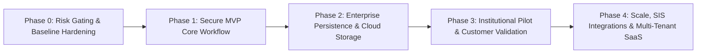

# FairExplain AI — Strategic Product & Engineering Roadmap

**Document Version:** 2.0 (Productization Roadmap)  
**Methodology:** Dependency-Aware Phase Gating (Phase 0 through Phase 4)  
**Target:** Transformation of Prototype into an Industry-Grade, Commercial Enterprise Product  

---

## Roadmap Overview & Phase Sequence



---

## Phase 0: Release-Blocking Risk Closure & Security Gating

**Objective:** Neutralize existential security vulnerabilities, stabilize integration tests, and establish the clean architectural baseline required before customer pilot deployment.

### Task 0.1: Server-Side Authentication & Object-Level Authorization (BOLA/IDOR)
* **Priority:** **P0 (Absolute Blocker)** | **Effort:** 5–7 Days
* **Rationale:** Current backend endpoints are 100% unauthenticated; student personal data and administrative decision endpoints are exposed to the public internet.
* **Dependencies:** None.
* **Affected Modules:** `backend/app/core/dependencies.py`, `backend/app/routers/`, `backend/app/models/user.py`.
* **Implementation Details:**
  1. Implement OAuth2 password bearer token flow using `python-jose` / `pyjwt` with HMAC-SHA256.
  2. Implement `get_current_user` and `require_role(["student", "reviewer", "admin"])` dependency providers.
  3. Enforce object-level ownership check on `GET /api/v1/application/{id}` (`application.user_id == current_user.id`).
* **Risks:** Breaking existing unauthenticated integration tests (which must be updated to use auth fixtures).
* **Verification & Definition of Done:**
  - Automated tests verify that unauthenticated calls return HTTP 401 Unauthorized.
  - Automated tests verify that student A calling `GET /api/v1/application/{id_of_student_B}` returns HTTP 403 Forbidden.
  - Reviewer endpoints reject requests lacking `reviewer` or `admin` role.

### Task 0.2: Integration Test Database Harness & CI Pipeline Fix
* **Priority:** **P0 (Absolute Blocker)** | **Effort:** 2–3 Days
* **Rationale:** 13 of 19 integration tests currently fail because they attempt to connect to a non-existent local database role (`role "user" does not exist`).
* **Dependencies:** Task 0.1.
* **Affected Modules:** `backend/tests/conftest.py`, `backend/tests/integration/`, `.github/workflows/ci.yml`.
* **Implementation Details:**
  1. Configure Testcontainers or an ephemeral PostgreSQL service container in GitHub Actions with credentials `postgres:postgres@localhost:5432/test_fairexplain`.
  2. Provide an async session fixture that executes migrations (`alembic upgrade head`) before tests and rolls back transactions per test case.
* **Verification & Definition of Done:**
  - `pytest backend/tests/integration backend/tests/e2e` passes with **100% green tests** in local environment and on GitHub Actions CI.

### Task 0.3: Secure Cloud Object Storage Adapter (S3 / Cloudflare R2)
* **Priority:** **P0 (Absolute Blocker)** | **Effort:** 3–4 Days
* **Rationale:** Current `LocalStorageBackend` writes files to local `./uploads`, which are wiped on container restart and lack access control.
* **Dependencies:** None.
* **Affected Modules:** `backend/app/core/storage.py`, `backend/app/routers/documents.py`.
* **Implementation Details:**
  1. Create `S3StorageBackend` using `aioboto3` supporting AWS S3, Cloudflare R2, or MinIO.
  2. Implement client upload via pre-signed S3 PUT URLs with strict MIME-type and size limits.
  3. Serve document downloads via short-lived (15-minute) pre-signed GET URLs accessible only to the document owner or authorized reviewers.
* **Verification & Definition of Done:**
  - Documents upload directly to S3 with server-side encryption (`AES256`).
  - Container reboot does not cause document loss.
  - Static direct file paths are removed from API responses.

---

## Phase 1: Narrowly Scoped, Testable MVP Core Workflow

**Objective:** Deliver one complete, flawless, and secure end-to-end user journey for Higher Education Scholarship Review.

### Task 1.1: Frontend Real Authentication & Session Integration
* **Priority:** **P0** | **Effort:** 4–5 Days
* **Rationale:** Replace frontend mock demo switcher with real login/registration forms and JWT session management.
* **Dependencies:** Task 0.1.
* **Affected Modules:** `frontend/src/lib/auth.tsx`, `frontend/src/pages/auth-page.tsx`, `frontend/src/services/api-client.ts`.
* **Implementation Details:**
  1. Build accessible login and registration forms with email/password validation.
  2. Store access token in memory / React context; refresh token in HttpOnly cookie.
  3. Attach `Authorization: Bearer <token>` automatically in Axios / fetch interceptors.
* **Verification & Definition of Done:**
  - Logging in as `priya@nitk.edu.in` authenticates against backend and displays student workspace.
  - Refreshing the browser silently renews access token without logging user out.

### Task 1.2: End-to-End Intake, Evaluation & Review Reconciliation
* **Priority:** **P0** | **Effort:** 4–5 Days
* **Rationale:** Ensure that submitting an application on the frontend immediately persists in PostgreSQL, evaluates criteria deterministically, generates an explanation, and surfaces in the reviewer queue.
* **Dependencies:** Tasks 0.1, 0.2, 1.1.
* **Affected Modules:** `backend/app/services/application_service.py`, `frontend/src/pages/student/apply-wizard.tsx`, `frontend/src/pages/reviewer/review-queue-page.tsx`.
* **Verification & Definition of Done:**
  - Submitting an application in the wizard creates records in `applications`, `academic_records`, `financial_profiles`, and `scholarship_evaluations`.
  - The case immediately appears in the Reviewer Queue with correct priority and flags.
  - Financial aid officer confirms recommendation; application transitions to `ready_for_report`.

### Task 1.3: Tamper-Evident Audit Report Download with SHA-256 Digest
* **Priority:** **P0** | **Effort:** 2–3 Days
* **Rationale:** Universities require an official paper/PDF record for Academic Senate and auditor approval.
* **Dependencies:** Task 1.2.
* **Affected Modules:** `backend/app/services/pdf/report_generator.py`, `frontend/src/pages/results-page.tsx`.
* **Verification & Definition of Done:**
  - Clicking "Download Official PDF" fetches the compiled ReportLab PDF blob.
  - PDF header and footer contain the cryptographic SHA-256 state digest.
  - Document opens cleanly in standard PDF viewers with no formatting defects.

---

## Phase 2: Enterprise Persistence, Privacy & Operational Controls

**Objective:** Comply with statutory data protection regulations (DPDP Act 2023) and harden production operational reliability.

### Task 2.1: DPDP Act 2023 Compliance & Consent Architecture
* **Priority:** **P0 (Statutory Mandate)** | **Effort:** 4–5 Days
* **Rationale:** Institutional processing of student data requires explicit, informed consent notices, purpose limitation, and verifiable parental consent for minors under 18.
* **Dependencies:** Task 1.1.
* **Affected Modules:** `frontend/src/pages/student/apply-wizard.tsx`, `backend/app/models/application.py`.
* **Implementation Details:**
  1. Add unbundled consent modal capturing timestamped affirmative consent before application submission.
  2. Implement date-of-birth validation; if student age < 18, require parent/guardian email and trigger Verifiable Parental Consent verification token.
  3. Implement data export endpoint (`GET /api/v1/user/export-data`) returning complete personal records in JSON format.
* **Verification & Definition of Done:**
  - Submissions without affirmative consent are rejected.
  - Export data endpoint produces complete archive of student dossiers and audit entries.

### Task 2.2: Multi-Tenancy Foundation (Tenant-Partitioned Data Schema)
* **Priority:** **P1** | **Effort:** 6–8 Days
* **Rationale:** Universities require dedicated tenant partitioning to prevent data leakage between competing institutions.
* **Dependencies:** Phase 0.
* **Affected Modules:** `backend/app/models/`, `backend/alembic/`, `backend/app/middleware/`.
* **Implementation Details:**
  1. Introduce `tenants` table (`id`, `name`, `slug`, `domain`).
  2. Add `tenant_id` foreign key with composite indexes across `applications`, `policies`, and `users`.
  3. Middleware resolves tenant from subdomain (e.g. `nitk.fairexplain.ai`) or user claims.
* **Verification & Definition of Done:**
  - Officer at Tenant A cannot query or view applications belonging to Tenant B.

### Task 2.3: Production Telemetry, APM & Backup Automation
* **Priority:** **P1** | **Effort:** 3–4 Days
* **Rationale:** Production deployment requires automated error tracking and disaster recovery.
* **Dependencies:** Phase 1.
* **Affected Modules:** `backend/app/main.py`, cloud infrastructure configuration.
* **Implementation Details:**
  1. Integrate Sentry SDK for backend exception monitoring and frontend error boundary tracking.
  2. Configure automated daily `pg_dump` with WAL archiving supporting 7-day point-in-time recovery.
* **Verification & Definition of Done:**
  - Simulated 500 error surfaces in Sentry with complete stack trace and sanitized headers.
  - Test database restore rehearsal succeeds from backup snapshot within 30 minutes.

---

## Phase 3: Institutional Pilot & Customer Validation

**Objective:** Deploy in a live university pilot environment, process real (or historical anonymized) scholarship cohorts, and validate user acceptance.

### Task 3.1: Historical Cohort Backtesting (1,000 Real/Anonymized Records)
* **Priority:** **P0 (Pilot Acceptance)** | **Effort:** 5–7 Days
* **Rationale:** Prove to university leadership that FairExplain AI's AST rule engine produces 100% concordant outcomes with past manual committee determinations.
* **Dependencies:** Phase 1.
* **Affected Modules:** `backend/app/domain/`, offline data loader scripts.
* **Verification & Definition of Done:**
  - 1,000 historical student dossiers evaluated through engine.
  - Discrepancy analysis identifies zero calculation errors; flags historical manual spreadsheet miscalculations.

### Task 3.2: 5 Structured University Discovery Interviews & UX Gating
* **Priority:** **P0** | **Effort:** 2 Weeks (Concurrent)
* **Rationale:** Confirm willingness to pay and validate reviewer workflow with actual Deans of Student Welfare.
* **Dependencies:** None.
* **Verification & Definition of Done:**
  - 5 documented interview transcripts.
  - Signed Pilot Letter of Intent (LOI) from at least one autonomous institution.

---

## Phase 4: Scale, Integrations & Advanced Capabilities

**Objective:** Expand platform reach with Student Information System (SIS) connectors and advanced document verification.

### Task 4.1: Student Information System (SIS) Connectors
* **Priority:** **P2** | **Effort:** 3–4 Weeks
* **Rationale:** Eliminate manual student grade entry by pulling CGPA and enrollment status directly from university ERPs (Samarth eGov, Ellucian, SAP, CollPoll).
* **Dependencies:** Phase 2, 3.

### Task 4.2: Government Vernacular OCR Adapter
* **Priority:** **P2** | **Effort:** 2–3 Weeks
* **Rationale:** Support parsing of state revenue certificates issued in regional Indian scripts (Hindi, Kannada, Telugu).
* **Dependencies:** Phase 2.

---

## Summary Roadmap Timeline & Milestones

```
+----------------------------------------------------------------------------------------------------+
|                                      ROADMAP PHASING TABLE                                         |
+---------+-----------------------------------+--------------------+---------------------------------+
| Phase   | Focus & Major Deliverables        | Target Duration    | Primary Go/No-Go Gate           |
+---------+-----------------------------------+--------------------+---------------------------------+
| Phase 0 | Security, Auth, S3 Storage, CI DB | 2 to 3 Weeks       | 100% Green CI; Zero Open IDORs  |
| Phase 1 | Secure MVP Intake-Review-Report   | 3 to 4 Weeks       | Verified End-to-End User Flow   |
| Phase 2 | DPDP Compliance, Multi-Tenancy    | 3 to 4 Weeks       | Statutory Privacy Audit Sign-off|
| Phase 3 | University Pilot & Cohort Test    | 4 to 6 Weeks       | 1,000-Student Pilot Acceptance  |
| Phase 4 | SIS Integrations & Scale          | 6 to 8 Weeks       | Commercial Expansion Milestone  |
+---------+-----------------------------------+--------------------+---------------------------------+
```

*Report continues in `product-audit/COMPETITIVE_AND_VALIDATION_RESEARCH.md`.*
