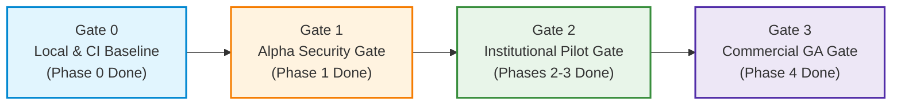
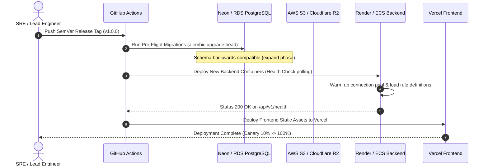
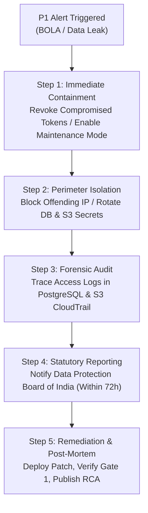

# FairExplain AI — Release Gates, Critical Risk Register & Operational Readiness

**Document Version:** 1.0.0  
**Effective Date:** October 25, 2026  
**Auditor / Architect:** Senior Product & Systems Architect  
**Scope:** Formal verification gates, enterprise risk register, operational runbooks, and sign-off criteria governing the transition of FairExplain AI from its current prototype state to Institutional Pilot and Commercial General Availability (GA).

---

## 1. Executive Summary & Purpose

Software that governs consequential financial and educational decisions—specifically scholarship distribution, tuition cap compliance, and student financial aid dossiers—cannot be deployed under Silicon Valley's traditional "move fast and break things" paradigm. An error in income calculation disenfranchises a deserving student; an unauthenticated endpoint exposes sensitive tax and family identity documents; a hallucinating generative AI alters legal eligibility criteria; and a missing database transaction boundary over-allocates institutional endowments.

This document establishes the **immutable release gates**, **risk mitigations**, **operational runbooks**, and **accountable governance structure** required before FairExplain AI can be entrusted with real institutional budgets, real student data, and legally binding financial aid determinations.

---

## 2. Multi-Tier Release Gate Hierarchy

FairExplain AI progresses through four sequential quality and security gates. Advancement across any gate requires 100% adherence to all mandatory exit criteria. No exceptions, temporary waivers, or "fix-in-next-sprint" overrides are permitted for security, data isolation, or calculation integrity criteria.



---

### Gate 0: Development & CI Baseline Gate (Remediated Prototype)
* **Target Objective:** Ensure the existing codebase can be tested, linted, built, and executed in an automated, reproducible environment without reliance on undeclared local workstation configurations.
* **Gate Owner:** Lead Software Engineer

| Dimension | Mandatory Exit Criteria | Verification Method | Status |
| :--- | :--- | :--- | :--- |
| **Domain Tests** | 100% pass rate across all 70 unit tests in `backend/tests/unit/` (Decimal math, priority queue, tuition non-negativity). | `pytest backend/tests/unit` | **PASSED** (70/70) |
| **Frontend Build** | Zero TypeScript compiler errors (`tsc --noEmit`), clean production build without lockfile drift. | `pnpm --filter frontend build` | **PASSED** (Commit `9ff5e2f`) |
| **Frontend Tests** | Unit tests for components pass with zero failures. | `pnpm --filter frontend test` | **PASSED** (10/10) |
| **Integration Test Harness** | Integration test suite executes against an ephemeral test PostgreSQL database container; eliminate hardcoded `user:password` requirement. | `docker compose -f docker-compose.test.yml up --abort-on-container-exit` | **BLOCKED** (`GAP-07-02`) |
| **Linting & Formatting** | Automated Ruff (backend) and ESLint/Prettier (frontend) pass with 0 errors. | `ruff check backend && pnpm lint` | **PENDING** (Phase 0) |

---

### Gate 1: Alpha / Security Remediation Gate (Prerequisite for Internal Test Deployments)
* **Target Objective:** Eliminate critical architectural vulnerabilities (Broken Object-Level Authorization, unencrypted local file storage, unauthenticated admin overrides) before any staging environment is connected to the internet.
* **Gate Owner:** Security & Infrastructure Lead

| Dimension | Mandatory Exit Criteria | Verification Method | Associated Gap ID |
| :--- | :--- | :--- | :--- |
| **Authentication** | Mandatory JWT / session token enforcement on all `/api/v1/application/*` and `/api/v1/admin/*` endpoints. Public access restricted exclusively to `/health`, `/auth/login`, and `/auth/register`. | Automated OWASP ZAP scan; authenticated test assertions for HTTP 401 on missing token. | `GAP-02-01` |
| **Authorization (BOLA)** | Strict tenant and user ownership verification: Student A cannot view Student B’s application (HTTP 403); Reviewer cannot review applications outside their assigned `institution_id`. | Automated regression tests verifying horizontal privilege escalation attacks fail. | `GAP-02-03` |
| **Object Storage Isolation** | Elimination of `LocalStorageBackend`. All documents written to AWS S3 / Cloudflare R2 with customer-managed SSE-KMS encryption and zero public bucket access. | AWS IAM policy check; verified document retrieval exclusively via short-lived (15-min) pre-signed URLs. | `GAP-03-01` |
| **Secrets Management** | Zero hardcoded API keys, JWT secrets, or DB passwords in code or environment template files. Dynamic injection via AWS Secrets Manager or Render Environment Groups. | `gitleaks detect` execution across git history; AST secret scanning in CI. | `GAP-02-05` |
| **Dependency CVE Scan** | Zero High or Critical Common Vulnerabilities and Exposures (CVEs) in Python or npm dependencies. | `safety check` and `pnpm audit --audit-level=high` in CI pipeline. | `GAP-07-03` |

---

### Gate 2: Institutional Pilot Release Gate (Controlled Deployment to 1–2 Higher Education Partners)
* **Target Objective:** Validate end-to-end institutional workflow (500 student applications, 3 financial aid officers) under real academic operating conditions with zero calculation drift, zero data leaks, and strict compliance with Indian DPDP Act 2023.
* **Gate Owner:** Head of Product & Compliance Officer

| Category | Mandatory Metric / Standard | Verification Mechanism | Threshold |
| :--- | :--- | :--- | :--- |
| **Mathematical Correctness** | Zero floating-point drift. 100% agreement between deterministic rule engine and institutional manual spreadsheet audit. | Parallel shadow calculation run across 500 historical sample applications. | **100.000% Concordance** (Zero variance) |
| **AI Safeguards** | Absolute programmatic isolation of LLM output. System prohibits any AI generated text from altering calculated award amounts or eligibility booleans. | Schema validator regression test verifying `/api/v1/review-decision` rejects payload if modified by LLM worker. | **0 Breaches** (Deterministic state is read-only to AI) |
| **System Availability** | Continuous API uptime during working office hours (08:00 – 20:00 IST) across a 30-day pilot cycle. | Datadog / BetterStack synthetic uptime monitor hitting `/api/v1/health`. | **≥ 99.5% Uptime** |
| **API Latency** | Deterministic eligibility & tuition accounting response time under load. | K6 load test simulating 50 concurrent financial aid reviewers. | **P95 < 250ms** |
| **LLM Dossier Streaming** | Time-to-first-token and complete generation time for plain-English explanation dossiers. | Production APM tracing on `/api/v1/application/{id}/explanation`. | **TTFT < 800ms; P95 Total < 4.0s** |
| **Document Retention** | Student identity proofs (Aadhaar, income slips) auto-purged or encrypted post-verification. Student consent explicitly logged with timestamp. | Database audit log inspection; S3 lifecycle policy check. | **100% Consent Logged**; Zero unencrypted PII at rest |
| **User Sign-Off** | Lead Financial Aid Officer (Partner University) formal acceptance of reviewer dashboard and batch decisioning. | Signed Pilot Acceptance Certificate (Form FA-PAC-2026). | **Written Sign-off from 2 Institutions** |

---

### Gate 3: Commercial General Availability (GA) Gate (Public Multi-Tenant SaaS)
* **Target Objective:** Full enterprise readiness: automated self-service onboarding, SOC2 Type I compliance, multi-tenant database isolation, automated disaster recovery, and contractual SLA enforcement.
* **Gate Owner:** Executive Steering Committee (CTO, CPO, Legal Counsel)

| Category | Mandatory Metric / Standard | Verification Mechanism | Threshold |
| :--- | :--- | :--- | :--- |
| **Multi-Tenancy Isolation** | Row-Level Security (RLS) active on all PostgreSQL tables with session context `app.current_tenant_id`. | Cross-tenant data injection penetration test conducted by external CREST-certified auditor. | **Zero Data Leakage Across Tenants** |
| **Disaster Recovery (RTO)** | Recovery Time Objective: Full service restoration from database snapshot and code redeployment. | Unannounced disaster recovery tabletop drill (simulated complete region/database loss). | **RTO < 60 Minutes** |
| **Data Recovery (RPO)** | Recovery Point Objective: Maximum acceptable committed transaction loss. | Continuous WAL archiving / Point-In-Time-Recovery (PITR) verification on Neon/AWS RDS. | **RPO < 15 Minutes** |
| **Audit Log Immutability** | All administrative approvals, overrides, and fund allocations written to append-only, tamper-evident audit table. | Cryptographic hash chaining or AWS CloudTrail / S3 Object Lock log verification. | **Zero Overwrites or Deletions Permitted** |
| **Contractual SLA** | Production infrastructure high availability across multi-AZ deployment. | 90-day SLA compliance report generated via APM monitoring. | **≥ 99.9% Production Availability** |
| **Legal & DPDP Compliance** | Data processing agreements (DPA) executed; Data Protection Officer (DPO) designated; Data Subject Request (DSR) workflows operational. | Third-party legal audit against India DPDP Act 2023 and EU GDPR Article 22. | **Formal Compliance Certificate Issued** |

---

## 3. Comprehensive Critical Risk Register

The following matrix documents the most severe operational, technical, legal, and financial risks threatening FairExplain AI, along with established controls, residual risk ratings, and accountable owners.

```
Risk Score = Likelihood (1–5) × Severity (1–5)
Critical (20–25) | High (12–19) | Medium (6–11) | Low (1–5)
```

| Risk ID | Category | Risk Description & Consequence | Likelihood (1-5) | Severity (1-5) | Risk Score | Pre-Mitigation Status | Mitigation & Architectural Control | Residual Score | Risk Owner |
| :--- | :--- | :--- | :--- | :--- | :--- | :--- | :--- | :--- | :--- |
| **RISK-01** | **Security / Privacy** | **Broken Object-Level Authorization (BOLA)**: Malicious actors enumerate `/api/v1/application/{id}` to scrape student PII, tax forms, and family income details. | 4 | 5 | **20 (Critical)** | Active in prototype (`GAP-02-03`). | Implement FastAPI RBAC dependency checking tenant ID and user ID matching against JWT claims. Enforce PostgreSQL RLS. | 4 (Low) | Lead Backend Engineer |
| **RISK-02** | **Infrastructure / Data** | **Transient Storage Data Loss**: Ephemeral container restarts on Render/Vercel wipe locally stored student identity documents and income proofs (`./uploads`). | 5 | 5 | **25 (Critical)** | Active in prototype (`GAP-03-01`). | Replace `LocalStorageBackend` with AWS S3 / Cloudflare R2 bucket featuring SSE-KMS encryption and versioning. | 3 (Low) | Infrastructure Lead |
| **RISK-03** | **AI Safety / Integrity** | **Generative AI Decision Drift**: LLM explanation pipeline hallucinates eligibility or alters recommended loan/scholarship amounts in UI payloads. | 3 | 5 | **15 (High)** | Prevented in domain, but missing strict UI schema enforcement. | Pure one-way data contract. LLM receives read-only JSON facts; Pydantic response schema rejects any numeric output from LLM. Persistent UI ribbon marks all text as non-binding. | 3 (Low) | Lead AI Engineer |
| **RISK-04** | **Regulatory / Compliance** | **DPDP Act 2023 Non-Compliance**: Unencrypted storage of student national IDs (Aadhaar) and parent income certificates leads to regulatory penalty up to ₹250 Cr. | 4 | 5 | **20 (Critical)** | Active in prototype (`GAP-04-03`). | Implement client-side masking, KMS envelope encryption for documents at rest, automated 180-day retention purge, and formal consent tracking. | 4 (Low) | Compliance Officer |
| **RISK-05** | **Financial Integrity** | **Endowment Over-Allocation via Concurrency Race**: Multiple financial aid officers simultaneously approve awards, exhausting pool funds beyond statutory budgets. | 3 | 4 | **12 (High)** | Active in prototype (`GAP-06-03`). | Wrap allocation state changes in `SELECT ... FOR UPDATE` row locks within atomic database transactions with serializable isolation. | 2 (Low) | Lead Database Architect |
| **RISK-06** | **Operational Stability** | **Database Connection Starvation**: Free/starter tier Neon/Render connection limits (20 connections) exhausted during campus admission batch review, causing 500 errors. | 4 | 4 | **16 (High)** | Active in prototype (`GAP-06-04`). | Deploy PgBouncer connection pooler in transaction pooling mode; configure SQLAlchemy pool size (10 max, 5 overflow) with aggressive recycling (1800s). | 3 (Low) | Infrastructure Lead |
| **RISK-07** | **Vendor Dependency** | **Third-Party LLM Provider Outage**: Groq / OpenAI API downtime completely freezes financial aid office application reviews. | 3 | 3 | **9 (Medium)** | Active in prototype. | Implement asynchronous decoupled worker queue (Celery/ARQ); if LLM is offline, deterministic rules render immediately with label: *"AI Explanation queued"*. | 2 (Low) | Lead Backend Engineer |
| **RISK-08** | **Commercial / Adoption** | **University Procurement Inertia**: Institutional sales cycles exceed 12 months due to centralized government or university syndicate tender rules. | 4 | 4 | **16 (High)** | Market reality. | Price initial pilot at sub-tender threshold (< ₹2.5L/year) accessible via departmental discretionary budgets; target private universities & CSR foundations first. | 6 (Medium) | Head of Product |

---

## 4. Accountable Operational Roles & RACI Framework

To ensure flawless operational execution and regulatory accountability, the following RACI (Responsible, Accountable, Consulted, Informed) matrix defines organizational ownership across critical lifecycle events:

* **Roles:**
  * **CPO / PM:** Head of Product & Release Manager
  * **SEC:** Security & Compliance Officer
  * **BE:** Lead Backend & Database Architect
  * **FE:** Lead Frontend Engineer
  * **OPS:** Infrastructure & On-Call Site Reliability Engineer

| Lifecycle Event / Task | CPO / PM | SEC | BE | FE | OPS |
| :--- | :---: | :---: | :---: | :---: | :---: |
| **Release Gate Sign-Off (G0 – G3)** | **A** | C | R | R | R |
| **Database Schema Migration (`alembic upgrade`)** | I | I | **A / R** | I | C |
| **Vulnerability Remediation (High/Critical CVEs)** | I | **A** | R | R | C |
| **KMS Encryption Key & Secret Rotation** | I | C | R | I | **A / R** |
| **P1 Security Incident Declaration & Containment** | C | **A** | R | I | R |
| **Data Subject Request (DPDP Erasure / Export)** | C | **A** | R | I | I |
| **Financial Rule Engine Modification** | **A** | C | R | I | I |
| **Production Rollback Decision** | **A** | I | C | I | R |

---

## 5. Standard Operational Runbooks (SOPs)

### Runbook 1: Production Deployment & Zero-Downtime Rollout

* **Objective:** Deploy updated backend and frontend code to production without dropping user requests or corrupting in-flight database transactions.
* **Pre-conditions:**
  1. Git commit is tagged on `main` and has passed all CI pipelines (Gate 0 & Gate 1).
  2. Database backup snapshot initiated and verified via Neon/RDS API.
  3. No active campus batch review occurring (scheduled maintenance window: 23:00 – 03:00 IST).



* **Step-by-Step Procedure:**
  1. **Lock Migration Window:** Notify financial aid officers via in-app banner 1 hour prior to rollout.
  2. **Execute Database Migrations:** Run forward-compatible migration:
     ```bash
     cd backend && alembic upgrade head
     ```
  3. **Deploy Backend Service:**
     - Render / ECS pulls verified Docker image SHA.
     - Spin up new instances; wait for `/api/v1/health` to return `{"status": "healthy", "database": "connected"}`.
     - Route traffic from old containers to new containers; gracefully drain existing connections (30-second termination grace period).
  4. **Deploy Frontend:**
     - Vercel automatically deploys static bundle with updated cache headers (`Cache-Control: public, max-age=31536000, immutable` for hashed assets; `no-cache` for `index.html`).
  5. **Post-Deploy Sanity Verification:**
     - Execute synthetic transaction: create test application, evaluate rules, stream explanation, verify database record.
     - Verify zero 5xx errors in Datadog/BetterStack for 15 minutes.

---

### Runbook 2: P1 Security Incident Response (Unauthorized Data Exposure / BOLA)

* **Trigger:** Any detection of horizontal privilege escalation (e.g., Student A retrieving Student B's application dossier), unauthorized access to S3 document storage, or leak of API keys.
* **Severity Level:** Priority 1 (Maximum Emergency)
* **Lead Responder:** Security Officer & On-Call Backend Engineer



* **Detailed Containment Steps:**
  1. **Immediate Session Termination:** If unauthorized access is detected via an active token:
     ```bash
     # Invalidate all active Redis refresh tokens or bump JWT secret epoch
     curl -X POST https://api.fairexplain.ai/internal/ops/revoke-sessions \
          -H "Authorization: Bearer $OPS_MASTER_KEY" \
          -d '{"action": "emergency_global_session_revoke"}'
     ```
  2. **Storage Lock:** If S3 bucket exposure is suspected:
     - Immediately attach restrictive bucket policy denying all unauthenticated `s3:GetObject` calls.
     - Rotate S3 IAM access credentials within 10 minutes.
  3. **Forensic Log Extraction:**
     - Export query access logs:
       ```sql
       SELECT * FROM audit_logs 
       WHERE created_at >= NOW() - INTERVAL '24 HOURS' 
         AND action IN ('READ_APPLICATION', 'DOWNLOAD_DOCUMENT')
       ORDER BY created_at DESC;
       ```
     - Identify all unique `student_id` records accessed by the rogue actor.
  4. **Regulatory & Victim Notification:**
     - Under Section 8(6) of India's DPDP Act 2023, notice must be served to the **Data Protection Board of India (DPBI)** and all affected data principals without delay (target: < 72 hours).
  5. **Root Cause Analysis (RCA):**
     - Draft comprehensive RCA document within 5 business days, identifying the specific code regression, test gap, and preventive controls installed.

---

### Runbook 3: P2 Incident Response (Financial Rule Drift or Calculation Anomaly)

* **Trigger:** Discrepancy detected between institutional fee structure and calculated tuition balance, or negative loan amount emitted.
* **Lead Responder:** Lead Backend Architect & Financial Domain Specialist
* **Action Steps:**
  1. **Halt Automated Batch Processing:** Switch the review queue to `MANUAL_REVIEW_ONLY` mode.
  2. **Isolate Affected Applications:**
     ```sql
     SELECT id, student_id, calculated_balance, remaining_need 
     FROM applications 
     WHERE remaining_need < 0 OR calculated_balance < 0;
     ```
  3. **Re-run Deterministic Invariants:**
     - Execute the pure domain calculator against the affected applications' frozen inputs.
     - If the domain calculator produces the correct result, inspect serialization layers or database write logic.
  4. **Execute Compensating Adjustments:**
     - Never update records directly via raw SQL without an audit trail.
     - Trigger an administrative override script that logs `RECALCULATION_DRIFT_CORRECTION` with the authorized officer's cryptographic signature.

---

### Runbook 4: Database Disaster Recovery & Point-In-Time Restore (PITR)

* **Trigger:** Catastrophic database corruption, accidental table truncation (`DROP TABLE`), or cloud provider region failure.
* **Target RTO:** < 60 minutes | **Target RPO:** < 15 minutes
* **Lead Responder:** Infrastructure & Database SRE

* **Execution Steps:**
  1. **Identify Corruption Timestamp ($T_{corrupt}$):**
     - Inspect database transaction logs and determine exact second of corruption.
     - Set target restore time $T_{restore} = T_{corrupt} - 60\text{ seconds}$.
  2. **Initiate Point-in-Time Restore via Neon / AWS RDS:**
     ```bash
     # Example CLI restore targeting point in time
     neonctl branches create --project-id $PROJECT_ID \
                             --name recovery-branch-$(date +%s) \
                             --point-in-time "$TARGET_ISO_TIMESTAMP"
     ```
  3. **Data Integrity Verification:**
     - Run checksum verification script against restored database:
       ```sql
       -- Verify total scholarship funds allocated equals sum of individual awards
       SELECT SUM(allocated_amount) FROM scholarship_allocations;
       SELECT COUNT(*) FROM applications WHERE status = 'RECOMMENDED_ELIGIBLE';
       ```
  4. **Switch Production Connection String:**
     - Update `DATABASE_URL` in backend secret store to point to restored database endpoint.
     - Trigger backend rolling restart.
  5. **Validate Service Functionality:**
     - Run automated smoke test suite against live production instance.

---

## 6. Formal Go / No-Go Decision Sign-Off Protocol

A release candidate cannot be deployed to an institutional pilot or commercial production environment without unanimous written sign-off from all designated stakeholders.

### Go / No-Go Sign-Off Sheet Template

```
================================================================================
                    FAIREXPLAIN AI — PRODUCTION RELEASE SIGN-OFF
================================================================================
Release Version: ______________________      Deployment Date: __________________
Target Environment: [ ] Staging / QA   [ ] Institutional Pilot   [ ] Production GA

MANDATORY CRITERIA VERIFICATION:
[ ] 1. All Gate exit criteria for current milestone verified 100% complete.
[ ] 2. Zero open Critical or High severity items in Risk Register.
[ ] 3. Zero open BOLA / Privilege Escalation security vulnerabilities.
[ ] 4. Automated unit, integration, and E2E regression tests passing (100%).
[ ] 5. Pure Decimal arithmetic verified against 100% of institutional edge cases.
[ ] 6. DPDP Act 2023 compliance controls and consent records active.
[ ] 7. Disaster Recovery PITR drill executed within previous 90 days.
[ ] 8. Lead Financial Aid Officer written pilot acceptance on file.

STAKEHOLDER SIGN-OFF:

1. Head of Product / Release Manager:
   Signature: __________________________   Name: ______________________   Date: ________
   Decision:  [ ] GO    [ ] NO-GO

2. Lead Security & Compliance Officer:
   Signature: __________________________   Name: ______________________   Date: ________
   Decision:  [ ] GO    [ ] NO-GO

3. Lead Backend & Systems Architect:
   Signature: __________________________   Name: ______________________   Date: ________
   Decision:  [ ] GO    [ ] NO-GO

4. Lead Frontend & Design Engineer:
   Signature: __________________________   Name: ______________________   Date: ________
   Decision:  [ ] GO    [ ] NO-GO

5. Site Reliability & Operations Lead:
   Signature: __________________________   Name: ______________________   Date: ________
   Decision:  [ ] GO    [ ] NO-GO
================================================================================
```

### Unconditional No-Go Triggers (Automatic Abort Conditions)
If any of the following conditions exist 24 hours prior to scheduled release, the deployment is **automatically aborted**:
1. **Any unresolved High or Critical CVE** in dependencies or container images.
2. **Any endpoint returning student PII** without verifying the requesting user's identity and institutional tenant membership.
3. **Any failure in the financial domain unit tests** (`backend/tests/unit/`).
4. **Any LLM prompt or output schema** that directly writes to or mutates financial eligibility calculation tables without human officer confirmation.
5. **Absence of automated point-in-time backups** covering the past 7 days.
