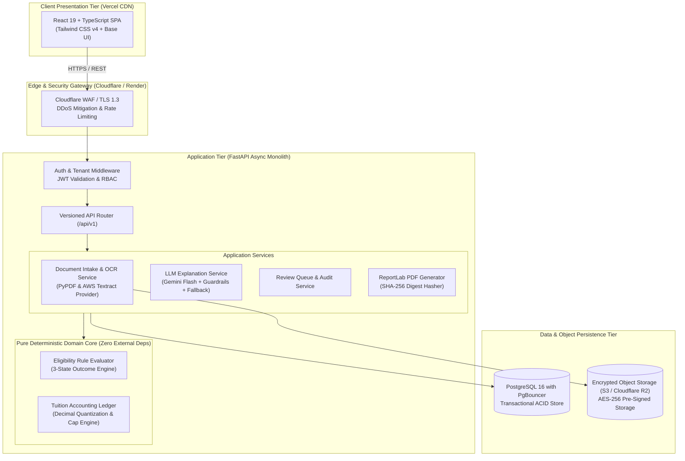
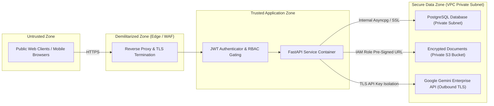
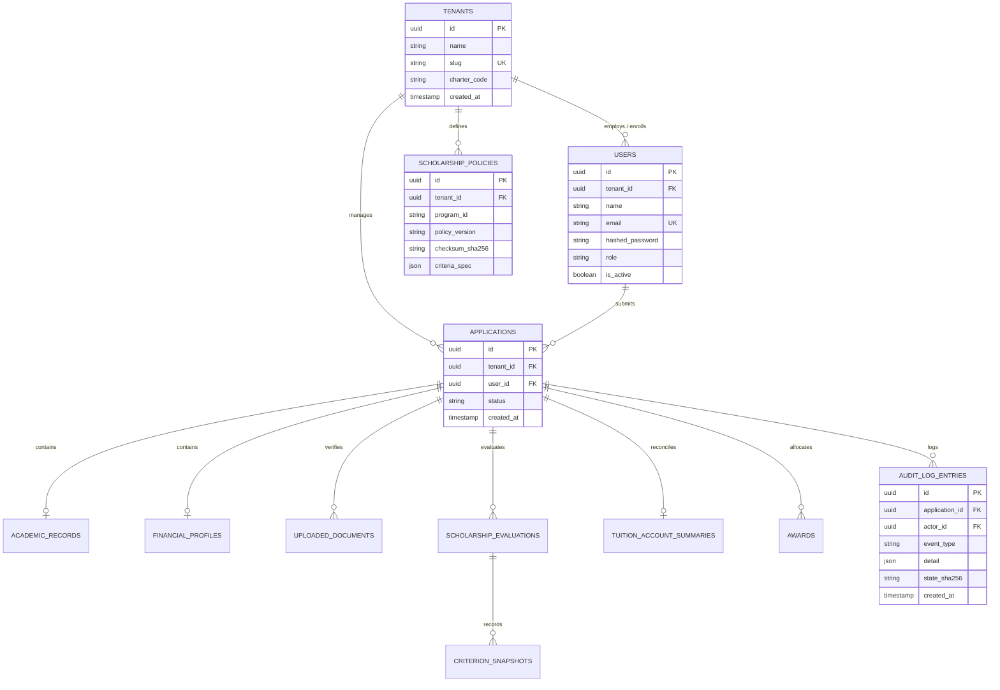

# FairExplain AI — Production Target Architecture Specification

**Document Version:** 2.0 (Production Release Target)  
**Author:** Principal Infrastructure & Systems Architect  
**Scope:** Production Deployment Topology, Trust Boundaries, Security Architecture, Data Integrity, and Observability.

---

## 1. Architectural Philosophy: The Sovereign Monolith

To avoid the operational overhead, network latency, and distributed transaction complexity of microservices, FairExplain AI adopts a **Modular Monolith** architecture:
* A single, robust **FastAPI** application orchestrating domain logic, async persistence, and API routing.
* A decoupled **React 19 + Vite** single-page application communicating via type-safe REST contracts.
* **PostgreSQL 16** as the single source of truth for persistent entity state and immutable audit append-logs.
* **Cloud Object Storage (S3 / R2)** for durable, encrypted document storage.

---

## 2. Trust Boundaries & Security Architecture

### Trust Boundary Invariants:
1. **Network Isolation:** The database (`PostgreSQL`) resides in a private VPC subnet and accepts connections only from the FastAPI container security group over SSL.
2. **Pre-Signed S3 Access:** Student documents are never proxied through the web server or exposed as public URLs. The backend issues short-lived (15-minute) pre-signed URLs only after verifying that the requesting user owns the document or holds an authorized reviewer role.
3. **AI Credential Isolation:** LLM API keys (`GEMINI_API_KEY`) reside exclusively in server-side environment variables and are never transmitted to frontend clients.

---

## 3. Authentication & Authorization Model (Closing Gaps 04-02 & 04-03)

### 3.1 Token Lifecycle
* **Access Tokens:** Signed with HMAC-SHA256 (`HS256`) using a 256-bit cryptographically secure secret. Expiration: 15 minutes. Contains claims: `sub` (User UUID), `tenant_id` (Institution UUID), `role` (`student`, `reviewer`, `admin`).
* **Refresh Tokens:** Stored in database table `user_refresh_tokens`, hashed with SHA-256, issued to clients as an `HttpOnly`, `Secure`, `SameSite=Strict` cookie. Expiration: 7 days. Supports immediate revocation upon logout or password change.

### 3.2 Role-Based Access Control (RBAC) Matrix

| Endpoint Group | Student Role | Reviewer Role | Admin Role | Security Guardrail |
|---|:---:|:---:|:---:|---|
| `POST /api/v1/application` | Create own | Create own | Create own | Binds `user_id = current_user.id` |
| `GET /api/v1/application/{id}` | Read own only | Read tenant-all | Read tenant-all | **Enforces Object-Level Ownership** |
| `POST /api/v1/documents/upload` | Upload own | Upload own | Upload own | Enforces `application.user_id == current_user.id` |
| `GET /api/v1/admin/review-queue` | **DENIED (403)** | Read tenant-all | Read tenant-all | Requires `role in (reviewer, admin)` |
| `POST /api/v1/admin/.../review-decision` | **DENIED (403)** | Sign determination | Sign determination | Logs immutable `AuditLogEntry` |
| `GET /api/v1/admin/analytics` | **DENIED (403)** | Read tenant-all | Read tenant-all | Aggregated statistical metrics only |
| `POST /api/v1/policy/...` | **DENIED (403)** | **DENIED (403)** | Create / update | Requires `role == admin` |

---

## 4. Database Schema & Multi-Tenancy Architecture

To support commercial higher education deployment, the database introduces an explicit `tenants` table with `tenant_id` foreign keys across all core models:

---

## 5. Security Threat Model (STRIDE Assessment)

| Threat Category (STRIDE) | Attack Vector | Potential Impact | Production Mitigation in Target Architecture |
|---|---|---|---|
| **Spoofing Identity** | Attacker crafts forged JWT or guesses demo session. | Unauthorized access to student records and aid queues. | Asymmetric RS256/HS256 signature verification; short token lifetime (15m); HttpOnly cookie refresh token rotation. |
| **Tampering with Data** | Attacker intercepts or modifies tuition reduction numbers. | Financial misallocation or fraudulent aid disbursement. | Mathematical calculations owned exclusively by pure Python AST engine; evaluation snapshot sealed with SHA-256 digest. |
| **Repudiation** | Reviewer overrides an aid decision and denies making it. | Unaccountable administrative bias and audit failure. | Mandatory written rationale (min 10 chars); immutable `AuditLogEntry` record with reviewer ID, timestamp, and digital signature. |
| **Information Disclosure** | IDOR on `GET /api/v1/application/{id}` or public `/uploads/`. | Leakage of student income certificates, PAN cards, marks. | Object-level ownership check (`app.user_id == user.id`); S3 pre-signed URLs with 15-minute expiration; SSE-KMS encryption. |
| **Denial of Service** | Flooding heavy ReportLab PDF compilation or Gemini endpoints. | Server exhaustion and legitimate application delays. | SlowAPI rate limiting (10 req/min per IP); Celery/Redis async background worker task queue for PDF and OCR tasks. |
| **Elevation of Privilege** | Student calls `POST /api/v1/admin/review-decision`. | Student self-approves own scholarship and fee reduction. | FastAPI role-gated dependency (`require_role(["reviewer", "admin"])`) enforced at router level. |

---

## 6. Observability, Reliability & Disaster Recovery

### 6.1 Telemetry & Metrics
* **Structured JSON Logging:** Monitored via Grafana Loki / Datadog using correlation IDs (`X-Correlation-ID`) injected by middleware.
* **APM & Error Tracking:** Sentry SDK integrated into `backend/app/main.py` capturing 100% of unhandled HTTP 500 exceptions with sanitized stack traces.
* **Health Probes:**
  * Liveness: `GET /health` &rarr; Returns HTTP 200 `{ status: "ok" }`.
  * Readiness: Probes database `SELECT 1` &rarr; Returns HTTP 200 `{ database: "connected" }` or HTTP 503 `{ database: "unreachable" }`.

### 6.2 Backup & Disaster Recovery Schedule
* **Automated Daily Backups:** Automated full `pg_dump` taken at 02:00 UTC daily, encrypted with GPG, and archived to a secondary cloud region (e.g., AWS S3 in `ap-south-1` replicating to `ap-southeast-1`).
* **Continuous Point-in-Time Recovery (PITR):** PostgreSQL Write-Ahead Logs (WAL) archived every 10 minutes, supporting recovery to any second within the past 7 days.
* **RTO & RPO Commitments:**
  * **RTO (Recovery Time Objective):** < 2 hours (provision replacement instance and restore backup).
  * **RPO (Recovery Point Objective):** < 15 minutes (maximum permissible data loss window).

---

## 7. Operational Trade-Offs

1. **Monolith vs. Microservices:** A single FastAPI service container is maintained. *Trade-off:* Microservices would increase operational complexity 5x without performance benefits at current institutional request volumes (< 50,000 requests/day).
2. **OCR Strategy (Local PyPDF vs. Cloud Textract):** The target architecture adopts a hybrid adapter: `PyPDFOCRProvider` handles clean digital PDFs instantly with zero cost, while AWS Textract / Google Document AI handles scanned photo uploads via an asynchronous worker.
3. **Database NullPool vs. PgBouncer:** Neon serverless PostgreSQL handles auto-scaling via `NullPool`; for enterprise self-hosted deployments, PgBouncer is deployed alongside the database container to pool persistent TCP connections.

*Report continues in `product-audit/PRODUCT_ROADMAP.md`.*
